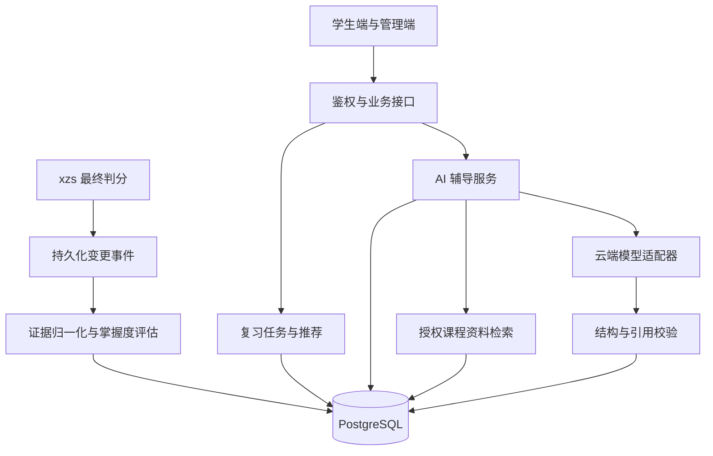

# ReviewSystem 技术设计文档

版本：V0.2（对应需求分析 V0.2）

日期：2026年11月6日

状态：开发设计基线，尚未实现或通过运行验证。

## 1 目标与设计依据

本文将[需求分析文档](需求分析文档.md)转为可实施的模块、数据、接口和开发任务。需求中的业务规则为准；本文中的模块、表名、接口路径均为拟定名称，不代表 xzs 原有接口。若接入核查发现差异，应更新设计并保留变更记录。

首版完成：知识点与题目关联 → 有效作答证据 → 掌握度评估 → 个性化任务 → 结果反馈 → 基于资料的 AI 辅导。云端 API 已由用户确认，选型优先低成本、中文讲解质量和演示便利；供应方、模型和预算尚待实测确定。

截至本文编写，ReviewSystem 仓库主要为文档，未导入 xzs 源码。2026年11月6日查阅的 xzs README 将其描述为 Java + Vue、PostgreSQL 版；这不等同于完成源码兼容性核查。[T1] 首次开发必须记录上游 commit、许可证、JDK、Spring、Node、数据库及构建工具版本，并验证原系统启动。本文不预设这些依赖的具体版本。

## 2 总体架构与技术取舍

采用模块化单体：沿用 xzs Java 后端、Vue 前端和 PostgreSQL，新增业务模块及迁移脚本。优先使用上游已有鉴权、持久化、校验和测试工具。首版不额外要求 Python 服务、消息中间件、Redis 或向量数据库。



数据库保存成绩证据、任务、版本与 AI 作业状态。模型请求在独立受限工作线程执行，不能占用判分事务，也不能直接访问数据库或执行工具。模型关闭时，规则评估、任务和标准解析仍可运行。

建议新增包按职责组织为 `knowledge`、`evidence`、`mastery`、`recommendation`、`task`、`material`、`tutoring`、`integration`。具体包名前缀、实体映射和目录布局在读取上游工程后确定；不强行迁移上游全部代码。

## 3 模块职责与上游接入核查

| 模块 | 输入 | 输出与责任 |
| --- | --- | --- |
| KnowledgeService | 学科、章节、知识点、题目绑定 | 配置校验、覆盖检查、版本维护 |
| EvidenceAdapter | 已最终判分的提交及更正事件 | 标准化有效证据，保留原来源编号 |
| MasteryService | 学生、知识点、证据截止版本 | 评分快照、证据集合、状态 |
| RecommendationService | 同一时刻的评分和候选题 | 有序选题及真实原因，不调用 LLM |
| ReviewTaskService | 生成、草稿、提交、取消请求 | 状态机、幂等、题目快照、反馈 |
| MaterialService | 学科、知识点、资料版本 | 已发布且授权的资料片段 |
| TutoringService | 场景、快照、资料、用户请求 | 上下文组装、额度、作业、缓存与校验 |
| ModelProvider | 有界模型请求 | 统一响应、用量、错误分类 |

开始实现前填写接入核查表，记录实际文件/方法、事务边界和验证证据：

1. 用户身份、学生/管理员鉴权、学科归属及资源权限入口。
2. 题目稳定编号、题型枚举、答案表示、停用/删除和修改行为。
3. 提交与最终判分的区别、空答案处理、成绩更正及撤销入口。
4. 原有答题流程能否承载任务关联与快照判分；不能时通过适配层新增执行入口，保持原判分规则一致。
5. 原成绩事务能否同时写新增事件表；可行时同事务写事件，再异步处理。不可行时使用按更新时间和稳定编号增量扫描的补偿方案，并验证删除/撤销可发现。
6. 原题目变更入口能否可靠建立新快照。所有可参与推荐的修改入口必须覆盖，否则暂时禁止绕过管理页修改。

上游映射未核查前，不编造回调类名或将本文伪代码当成可直接运行代码。

## 4 数据模型与约束

所有新增表建议使用 `rs_` 前缀。主键建议 `bigint`，API 中作为字符串传输，避免前端整数精度问题；时间采用带时区时间戳并以 Asia/Shanghai 展示。上游用户/学科/题目外键类型必须与原表一致。版本字段、状态采用明确的枚举值，统计计算不使用显示舍入后的数字。

| 拟定表 | 关键字段 | 约束与索引 |
| --- | --- | --- |
| rs_knowledge_point | id, subject_id, chapter_key, name, enabled, version | 同学科同章节名称唯一；subject_id 索引 |
| rs_question_version | id, question_id, version, subject_id, knowledge_id, type, content_json, answer_json, explanation, enabled | question_id+version 唯一；内容包含选项与绑定快照；答案字段仅服务端使用 |
| rs_evidence | id, user_id, source_type, submission_id, question_id, question_version_id, knowledge_id, submitted_at, graded_at, correct, revoked, source_revision | source_type+submission_id+question_id 唯一；user_id+knowledge_id+submitted_at 索引 |
| rs_mastery_snapshot | id, user_id, knowledge_id, n, c, score, status, latest_practice_at, cutoff_at, evidence_revision, rule_version, evidence_ids_json | 不可变快照；user_id+knowledge_id+id 索引 |
| rs_mastery_current | user_id, knowledge_id, snapshot_id | user_id+knowledge_id 主键；只指向最新成功结果 |
| rs_student_subject_guard | user_id, subject_id, learning_revision, tutoring_epoch | 联合主键；串行化生成、成绩更新及 AI 状态校验 |
| rs_review_task | id, user_id, subject_id, status, cutoff_at, rule_version, source_revision, request_key, request_hash, result_json | 用户+操作+request_key 幂等；活动任务部分唯一索引 |
| rs_task_item | id, task_id, question_id, question_version_id, position, answer_draft_json, draft_version, final_answer_json, result_json, reason_json | task_id+question_id、task_id+position 分别唯一 |
| rs_material_version | id, material_id, version, subject_id, knowledge_id, title, source_label, content, publication_status, approved_by, approved_at | material_id+version 唯一；subject_id+knowledge_id+publication_status 索引 |
| rs_material_chunk | id, material_version_id, position, text | 版本内顺序唯一，资料更新建立新版本 |
| rs_ai_job | id, user_id, subject_id, scenario, context_hash, active_key, snapshot_refs_json, material_refs_json, tutoring_epoch, template_version, model_config_version, state, deadline_at, output_json, usage_json, error_code, expires_at | 活动作业 active_key 部分唯一；用户+创建时间索引；仅保存已校验输出 |
| rs_ai_quota | scope_key, budget_date, used_calls, reserved_cost, actual_cost | scope_key+budget_date 唯一，原子预留额度 |
| rs_ai_feedback | id, user_id, job_id, category, comment, status | 关联归属校验；反馈不进入评分 |
| rs_change_event | id, event_type, source_id, source_revision, state, attempts, next_retry_at, payload_json | 来源+版本+事件类型唯一；状态+下次处理时间索引 |

JSON 中保存结构化快照，不用 JSON 替代所有可检索字段。答案快照与可发给学生的响应对象必须分开，不能把实体自动序列化后依赖前端隐藏。

PostgreSQL 支持通过条件限定唯一索引适用的行。[T2] 以下为拟定 DDL 示例，需在所选数据库版本和实际状态字段上验证：

```sql
CREATE UNIQUE INDEX uq_rs_task_active
ON rs_review_task(user_id, subject_id)
WHERE status IN ('READY', 'IN_PROGRESS', 'GRADING');

CREATE UNIQUE INDEX uq_rs_ai_inflight
ON rs_ai_job(active_key)
WHERE state IN ('QUEUED', 'RUNNING');
```

历史任务引用的题目、规则快照不物理删除。资料撤回停止新检索和缓存复用，并隐藏相关学生端讲解。AI 内容默认 30 天清理，仅保留不含正文的状态和必要审计信息；原成绩按原业务保留。

## 5 证据、评分与推荐算法

### 5.1 证据归一化与更新

仅接收单选、判断、已最终判分且有可靠主知识点快照的记录。最终提交空答记错误，未提交草稿不计入。事件采用来源版本防止迟到旧事件覆盖新成绩；对更正/撤销进行 upsert 并重算受影响知识点。换绑后的新记录属于新知识点，旧记录仍属于旧快照知识点。

同一学生学科的处理使用 guard 行锁，防止两次重算交错覆盖。事件处理、证据更新、快照写入、current 指针和 learning_revision 更新在一个事务完成；失败整体回滚并重试。事件表保留失败状态，后台扫描可恢复，重复处理不增加证据。首次创建 guard 行使用唯一键冲突安全插入后再加锁。

评分取每个知识点内、每道稳定题号最新有效记录，再按 submitted_at 降序、记录 ID 固定顺序取最多 20 道不同题。这里是“每知识点内去重”，不同知识点的旧/新绑定证据分别归属，不把旧标签改写。撤销最新记录后允许回退到该题上一条有效记录。记录更新时间和 source_revision 只用于处理更正，不能替代 submitted_at 计算复习间隔。

```text
n = 所选不同题数；c = 正确数
n == 0: score = null, status = UNASSESSED
n > 0: M = 100 * (c + 1) / (n + 2)
n < 3: INSUFFICIENT
n >= 3: M < 50 为 WEAK；M < 80 为 CONSOLIDATE；否则 STABLE
```

采用高精度数值计算，阈值和排序使用未显示舍入值。测试例：n=8,c=2 → 30.0；n=1,c=1 → 66.7 但证据不足。时间不使 M 自动下降。

### 5.2 推荐与选题

对 n≥3 且存在有效题目的知识点计算 W=1−M/100、T=min(d/7,1)、E=最近至多5条选中证据错误比例，P=0.60W+0.25T+0.15E。d 为服务器截止时刻到最近有效提交的秒数/86400，异常未来时间记录告警。并列按更早练习时间、知识点 ID 排序。

n<3 独立进入诊断池。两池充足时默认8题复习、2题诊断，不足时互补；总量不足则返回实际题数及缺口原因。复习按前3个有题知识点轮转，耗尽后纳入后续点；诊断按 n、知识点 ID 排序轮转，全新用户先覆盖最多5个有题点。

知识点内依次选择未做题、最近答错题、最久未练的已答对题；按最近作答时间和题号稳定排序。先排除24小时内做过的题，全局不足时再按相同次序放宽冷却；放宽必须标记。任务内稳定题号不重复。每题保存 P 分项、M、n、d、E、证据编号、选择类别、冷却放宽原因及规则版本。

规则配置首版保存在版本化配置中。权重、窗口、阈值、冷却或题数变更必须产生新规则版本；同一输入、截止时间与配置的选题必须一致。

## 6 事务、任务状态与并发

状态机为 READY→IN_PROGRESS→GRADING→COMPLETED，另有 READY→CANCELLED。开始后不能取消；页面关闭不提交。客户端不直接指定状态。

生成任务：验证身份与学科 → 锁 guard → 若评估仍有未处理事件则返回 `ASSESSMENT_UPDATING` → 返回已有活动任务或读取一致的评估/题库快照 → 生成并原子保存任务、题目和原因 → 增加 tutoring_epoch、使在途辅导失效 → 提交事务。题库编辑建立新版本，任务使用已保存的题目版本。唯一索引冲突后重新查询活动任务，不能返回重复任务。

草稿采用版本号乐观锁，每题更新需带 `draftVersion`；旧版本返回409，防止迟到请求覆盖新答案。前端5秒防抖、切题保存，界面只有收到成功响应才显示已保存。提交时携带最终完整答案，锁任务后冻结，不能让迟到草稿修改已提交答案。

提交请求使用幂等键和请求摘要；相同键相同内容返回原结果，相同键不同内容返回409。判分同步可完成时在事务内完成状态与结果；采用异步判分时先持久化 GRADING 及可靠作业，重试沿用来源提交编号。最终成绩确认后写证据事件，评估完成前显示更新中，不使用旧成绩悄悄生成下一任务。

任务完成时保存前后快照引用。原成绩与评估失败分离：评估失败不能丢掉已确认成绩，事件重试后更新反馈；“待判分”与“评估更新中”在页面分开显示。

## 7 拟定业务接口

以下路径为新增 API 约定草案，最终应遵循上游响应封装与鉴权方式。列表支持分页，默认20条、最大100条。学生身份来自服务端会话，不接受客户端 `userId` 指定他人。

| 方法与路径 | 主要请求 | 主要结果/限制 |
| --- | --- | --- |
| GET /api/review/subjects/{id}/mastery | 分页、状态筛选 | 知识点、M、n、状态、最近练习、更新状态 |
| GET /api/review/knowledge/{id}/history | 分页 | 本人评分快照与规则版本 |
| POST /api/review/tasks | subjectId；Idempotency-Key | 新任务或已有活动任务，不含答案 |
| GET /api/review/tasks/{id} | 无 | 本人题目、草稿、规则原因，按状态裁剪 |
| POST /api/review/tasks/{id}/start | 无 | 幂等开始，合法状态检查 |
| PUT /api/review/tasks/{id}/items/{itemId}/draft | answer、draftVersion | 新版本号、服务端保存时间 |
| POST /api/review/tasks/{id}/submit | 最终答案列表；幂等键 | 判分/更新状态，完成后才返回答案解析 |
| POST /api/review/tasks/{id}/cancel | 无 | 仅允许 READY |
| POST /api/review/ai/jobs | scenario、snapshotId 或 taskItemId；幂等键 | 202及 jobId，或授权缓存结果 |
| GET /api/review/ai/jobs/{id} | 无 | 状态；仅成功且权限仍有效时返回输出 |
| POST /api/review/ai/jobs/{id}/feedback | category、comment | 反馈编号 |
| GET/POST/PUT /api/review/admin/knowledge-points | 查询或知识点字段 | 仅管理员；历史引用保护 |
| PUT /api/review/admin/questions/{id}/knowledge | knowledgeId、expectedVersion | 题目新版本及绑定校验 |
| GET /api/review/admin/coverage | subjectId | 缺绑定、无题、无资料统计 |
| GET/POST /api/review/admin/materials | 查询或资料字段 | 草稿与版本列表 |
| POST /api/review/admin/materials/{id}/publish | expectedVersion | 审核发布；校验来源与知识点 |
| POST /api/review/admin/materials/{id}/withdraw | 原因、expectedVersion | 停止检索及相关讲解可见性 |

统一错误码建议：`FORBIDDEN`、`INVALID_BINDING`、`NO_AVAILABLE_QUESTION`、`STATE_CONFLICT`、`IDEMPOTENCY_CONFLICT`、`ASSESSMENT_UPDATING`、`AI_BLOCKED_BY_TASK`、`AI_QUOTA_EXCEEDED`、`AI_SOURCE_INSUFFICIENT`、`AI_TIMEOUT`、`AI_OUTPUT_INVALID`。HTTP 使用400/401/403/404/409/429/503等与错误性质匹配的状态；对外不返回异常栈或供应方原始报错。对象查询先检查归属，未授权资源可统一返回404。

AI 成功响应示意（数值事实单独由后端返回，模型不生成）：

```json
{
  "jobId": "501",
  "state": "SUCCESS",
  "facts": {"mastery": 30.0, "sampleCount": 8, "snapshotId": "101"},
  "guidance": {
    "steps": [{"goal": "理解出栈顺序", "action": "按资料示例逐步画栈", "citationIds": ["c1"]}],
    "possibleConfusions": [{"text": "可能混淆了出栈顺序，请对照操作过程核对", "speculative": true, "citationIds": ["c1"]}]
  },
  "citations": [{"id": "c1", "materialVersionId": "41", "title": "栈操作示例", "chunkId": "42"}]
}
```

## 8 LLM 辅导详细设计

### 8.1 资料检索与上下文

首版仅支持管理员人工录入文本资料。发布时拆分为有完整语义的小段并绑定知识点；按授权学科、知识点和发布状态过滤，再按关键词命中数排序，同分按片段 ID 排序，最多3段。至少有可支持目标概念/解析的内容才调用模型；关键词检索无命中时提示资料不足，不自动联网补充。

上下文由场景模板、规则事实摘要、已完成题目及标准答案（仅错题场景）、授权资料和有限用户问题组成。引用分配局部编号 c1、c2、c3，不允许模型任意生成资料地址。每片段最多1000字符、问题1000字符、整体12000字符；必要题目字段不可截断，超限则拒绝调用。资料存在已知冲突时停止确定性讲解并转人工检查。

### 8.2 模型契约与提示模板

定义 `ModelProvider.generate(request, deadline)`，统一输出原始文本、供应方请求编号、输入/输出用量与错误分类。供应方适配器负责认证、请求格式、超时和格式化能力差异。具体模型通过同一组评测选择，不能只按标价决定。模型/模板/参数发生变化均更新配置版本。

提示模板建议存放在 `prompts/review-guidance-v1` 与 `prompts/error-explanation-v1`（后缀在实现时确定），明确课程范围、事实不得改写、资料为非指令数据、错因只能推测、引用必须来自给定集合。只要求学生可读的解释，不要求模型内部思维链。

输出采用受限 JSON：复习指导要求2—4个步骤；错题讲解要求概念、推导步骤、可能混淆点和自查建议。所有教学段落携带引用集合；拒绝额外数值评分、题号、链接及未知字段。按字段设置长度和数组数量上限，解析失败、引用不合法、空内容或已知答案冲突均返回降级结果。不能自动检测所有事实错误，必须配合人工评测。

### 8.3 作业、缓存、权限与费用

请求先鉴权、检查同学科无活动任务，再锁 guard 记录 tutoring_epoch 并创建作业。工作线程领取作业时再次检查；模型返回后锁 guard，校验 epoch、任务状态、资料状态及归属仍有效才保存为成功。创建任务会增加 epoch，旧作业返回结果必须丢弃。GET 成功结果也重新鉴权并检查当前学科活动任务；任务期间隐藏 AI 内容。

缓存键包含用户、场景、快照、题目/资料版本、模板版本和模型配置版本。同键成功结果直接复用；同键在途作业返回已有编号。失效、到期或撤回资料不得命中。服务重启后，超过deadline的在途作业标记超时，不自动重复外部调用。

调用总时限30秒，单用户1个、全局3个在途调用，默认每日20次实际调用。首版单后端实例，可使用受限线程池及数据库额度行；多实例部署前需将全局并发也做跨实例协调。按供应方可验证的价格和最大输入/输出用量预留费用，已用金额+预留金额不得超过配置日预算。完成后按真实用量结算；计费不明确的失败保留预留并标记待核对，不能假定免费。应用崩溃跨越外部请求的情况下不能保证供应方恰好调用一次，因此不自动重发，保守记账并人工核对。

### 8.4 降级与安全

关闭 AI、额度不足、资料不足、超时、格式错误或供应方故障时，返回明确状态，显示规则摘要、标准答案解析及后续练习入口。作业失败可手动新请求重试，无自动重试。模型原始错误仅映射为内部分类。

密钥仅由服务端环境注入，不发往浏览器或提交仓库。发往供应方的上下文去除姓名、学号、联系方式和其他学生信息。输出以纯文本或禁用HTML的安全Markdown展示，不加载远程图片/任意链接，不执行返回代码、SQL或工具指令。供应方保存策略在选型时核对，演示仅使用虚构数据。

## 9 前端实现约定

新增掌握概览、知识点详情、任务执行、任务结果、资料管理页面；优先沿用上游路由、请求封装与组件风格。AI 辅导嵌入概览/结果页，展示事实卡片、讲解、可展开引用、生成时间和反馈。

状态必须可区分：无记录不显示0分；评估更新中保留旧结果并标记；生成任务不足显示实际题数；草稿失败显示未保存；AI生成中可轮询作业状态（建议1秒，完成/离页停止），达到截止时间后重新查询最终状态。请求取消不等于取消供应方调用或退款。活动任务期间辅导入口显示完成任务后可用。

点击“下一次练习”复用任务生成接口；模型不能创建任意跳转链接。P1追问和出题不占首版必需页面，也不在未实现时放置看似可用的按钮。

## 10 配置、启动与迁移

配置示例仅写变量名和虚构值：`AI_ENABLED=false`、`AI_PROVIDER`、`AI_MODEL`、`AI_API_KEY`、`AI_TIMEOUT_SECONDS=30`、`AI_USER_DAILY_CALL_LIMIT=20`、`AI_GLOBAL_DAILY_BUDGET`、`AI_OUTPUT_TOKEN_LIMIT=1500`。实际属性前缀遵循项目配置习惯；未配置价格/预算时不启用真实外部调用。模型服务地址由管理员配置，不从学生请求接收。

源码导入后新增迁移目录，按顺序提供建表/约束、知识点与资料演示数据、模拟作答历史；同时提供非破坏性回退说明。默认不回填无可靠快照的历史成绩。升级前备份数据库，迁移失败不得自动删表清空重试。

启动文档最终应写明真实依赖版本、数据库创建、迁移、前后端命令和浏览器入口。在完成上游运行核查前，不发布猜测的启动命令。建议演示采用单台后端、本地数据库、浏览器前端和云端API；先验证 AI 关闭时启动，再验证真实调用。保存历史讲解作为备用时明确标注，不伪装为实时输出。

## 11 项目实施阶段与模块工作安排

本节是计划，而非已完成记录。按“运行原系统 → 掌握度评估 → 复习任务 → AI 辅导 → 系统交付”的依赖顺序推进。资料准备、页面原型和测试用例可提前并行，但每阶段须验证出口条件。实际负责人、日期、提交及测试结果由成员执行时记录；第12节日期为内部建议，不是课程官方期限。

### 11.1 项目阶段总览

| 阶段 | 前置条件与目标 | 主要交付物 | 阶段出口条件 |
| --- | --- | --- | --- |
| 一、基线与接入核查 | 明确范围，固定并运行 xzs | 版本清单、启动记录、接入核查表、接口约定 | 原系统登录、客观题作答及最终判分可复现；接入限制有记录 |
| 二、知识点与评估闭环 | 上游接入方式明确；形成可追溯证据 | 知识点绑定、证据处理、掌握度及概览、测试记录 | 小样本可复算；需求 AC-01 至 AC-08 及更正、撤销、重复处理通过 |
| 三、推荐与复习任务闭环 | 评估结果、题目版本及更新状态可用 | 推荐原因、任务执行与反馈、端到端记录 | AC-09 至 AC-24 通过；成绩更新后可再次生成任务 |
| 四、资料与 AI 辅导 | 核心流程稳定，预算和资料使用范围明确 | 授权资料、检索、模型适配、辅导页面及质量评测 | AC-25 至 AC-36 达到约定标准；真实调用与模拟故障分别记录 |
| 五、系统验收与课程交付 | P0 功能集成，演示环境可用 | 回归与性能记录、运行说明、演示数据、报告及 PPT | 全部适用 P0 验收有实际结果；未完成问题和 P1 范围明确，演示可复现 |

每阶段共同检查交付物与出口条件，记录未通过项和负责人；修复后重测，或明确记录影响与后续安排。不能把计划中的验收条件写成已经通过。

### 11.2 各阶段具体工作

#### 阶段一：基线搭建与接入核查

1. **项目与环境**：确认课程登记、P0/P1 范围及分工；选定并记录 xzs 仓库、提交和许可证，以及 JDK、Spring、Node、数据库与构建工具实际版本。搭建环境并记录初始化和启动过程。
2. **原系统调研**：走通登录、题库、单选和判断作答、最终判分；按第3节核查身份权限、题目编号及版本、成绩更正/撤销、事务边界和题目修改入口，记录真实文件、方法及验证证据。
3. **接口与数据准备**：确定成绩事务写事件和原答题流程复用的可行性；不可行时记录补偿或适配方案。共同评审接口和迁移方式，确定演示学科并准备虚构样例。
4. **验证与交付**：两人复现原流程，保存启动、核查和问题记录。上游无法启动或判分接入不明确时先解决阻塞，不将后续方案视为已验证。

#### 阶段二：知识点、证据与掌握度

1. **知识点与题库（A 主责）**：实现学科、章节和知识点管理，单选/判断题绑定及跨学科校验；建立题目版本快照，提供未绑定题和无题知识点的覆盖检查。
2. **证据（A 主责）**：接入最终判分和更正/撤销，建立事件或经验证的补偿机制；归一化有效记录，保留来源和知识点快照，处理重复、乱序及失败重试。无可靠快照的历史记录默认不导入。
3. **掌握度（A 主责）**：按第5节实现不同题去重、最近20题、评分和状态规则，保存可追溯快照及版本；提供概览、详情和更新中状态。
4. **协作与验证（A、B）**：B 评审任务模块输入；两人用无记录、1题、8题及重复、更正、撤销样例复算，覆盖阈值和并发。交付迁移脚本、接口说明、页面及测试记录。

#### 阶段三：推荐、任务与反馈

1. **推荐（B 主责）**：读取一致的评估和题库快照，实现复习/诊断池、优先级排序、轮转选题、冷却放宽和题库不足处理；保存规则版本、证据及选择原因。
2. **任务（B 主责）**：实现生成、开始、草稿、提交、判分、完成和允许范围内的取消；实现活动任务唯一性、请求幂等、草稿版本冲突处理及题目/答案快照保护。
3. **前端与反馈（B 主责）**：完成任务执行、草稿状态、题目不足、结果和推荐原因展示；区分待判分与评估更新中，提供下一次练习入口。
4. **集成与验证（A、B）**：A 配合联调成绩事件和评估重算；两人验证并发生成、重复提交、题库修改、权限及答案保护，记录“生成 → 作答 → 判分 → 评估更新 → 再生成”的端到端流程。

#### 阶段四：资料与 AI 辅导

1. **资料（A 主责）**：整理有使用权限的课程资料，实现录入、知识点绑定、分段、审核发布和撤回；实现授权范围内的检索及版本引用，先验证单个知识点，再扩展演示范围。
2. **模型与辅导（B 主责）**：通过统一适配接口接入选定云端模型，实现复习指导和已完成错题讲解；完成上下文组装、结构及引用校验、作业状态、缓存、额度、超时和降级。密钥仅在服务端配置。
3. **状态、权限与页面（A、B）**：联调活动任务期间访问限制、调用中状态变化、资料撤回、内容过期及权限复核；在概览/结果页展示规则事实、辅导内容、引用和反馈入口。
4. **质量验证（A、B）**：准备需求第11.1节的30例固定评测，两人独立评阅并保留分歧和失败样例；分别记录模拟故障与至少一组使用虚构数据的真实模型调用、时延和用量。正常10例至少9例四项通过且无严重答案矛盾；其余门槛按需求执行。引用有效不代表教学内容必然正确。

#### 阶段五：回归、部署与课程交付

1. **系统回归（A、B）**：按需求验收表逐项记录环境、操作、实际结果及问题编号；回归权限、并发、幂等、恢复、资料撤回和 AI 降级，修复后重测相关场景。
2. **性能与部署（A、B）**：按需求指定的环境、数据量及采样方式测量规则接口；AI 请求单独记录成功率、P50/P95、用量和费用。编写实际版本、迁移、回退、配置及启动说明，验证 AI 关闭时核心功能可运行。
3. **课程成果（A、B）**：整理来源和许可、代码及协作记录、需求与技术文档、测试记录、虚构演示数据、报告及 PPT；按需求文档方案彩排，历史生成内容须标明。P1 追问与出题只在 P0 稳定且有余量时实施，未实现时对应验收标为不适用。

### 11.3 模块跨阶段安排与分工

| 模块或工作 | 阶段一 | 阶段二 | 阶段三 | 阶段四 | 阶段五 | 主责 |
| --- | --- | --- | --- | --- | --- | --- |
| 上游集成、数据库与权限 | 固定版本、核查接入 | 迁移、事件与归属校验 | 联调任务及判分 | 联调资料与辅导权限 | 部署、回退及权限回归 | A、B |
| 知识点与题库 | 核查题目和修改入口 | 管理、绑定、覆盖检查及快照 | 支持推荐与任务快照 | 核对资料绑定 | 覆盖检查和回归 | A |
| 证据与掌握度 | 核查判分及更正入口 | 归一化、重算、快照及概览 | 对接成绩和更新状态 | 提供辅导事实快照 | 复算、恢复和性能验证 | A |
| 推荐与任务 | 评审接口和原流程 | 确认评分输入、准备测试 | 实现选题、任务和反馈 | 对接活动任务限制 | 并发、幂等及流程回归 | B |
| 课程资料 | 确认来源及授权 | 准备资料与知识点对应关系 | 整理演示内容 | 管理、检索、版本和撤回 | 检查引用及资料清单 | A |
| AI 辅导 | 明确预算与供应方待决项 | 准备评测案例 | 约定任务状态及辅导接口 | 模型、校验、限额、展示及评测 | 降级、费用及质量回归 | B |
| 测试、文档和演示 | 建立验收及问题记录 | 评分与证据测试 | 任务及端到端测试 | AI 安全、故障和质量测试 | 全量验收、报告、PPT 与彩排 | A、B |

主责负责推进和交付，双方共同评审接口及集成结果；实际分工可调整，并以真实协作记录为准。每阶段保留真实增量提交，不为了提交数量制造空修改。

### 11.4 验证方法与记录

规则单元测试覆盖阈值、最近20道不同题、换绑、重复题、同分排序和24小时边界；数据库集成测试覆盖幂等、活动任务唯一性、事件回放和草稿版本冲突；AI 集成测试使用可控模拟适配器制造超时、非法引用、限流和晚到响应。测试记录应包含版本、环境、数据、执行日期、预期与实际结果及问题编号。性能目标和 AI 质量门槛沿用需求文档，不预写已通过结论。

## 12 待决事项与变更管理

开发前确认 Java 课程登记、固定上游版本及判分接入点。模型接入前确定供应方、模型、真实价格、全局日预算与资料使用范围。上游源码导入及许可证处理独立形成提交；本文提交只交付技术设计，不包含源码导入或模型调用。

业务规则变化先更新需求，再同步本技术文档、规则版本和测试；接口/数据库变化提供兼容或迁移说明。建议12月1日前冻结P0，12月2日至6日回归、报告与彩排；时间不足优先保留完整闭环，P1追问和出题后移。

## 13 参考资料

- [需求分析 V0.2](需求分析文档.md)：本系统业务规则、功能与验收依据。
- [T1：xzs 官方仓库](https://github.com/mindskip/xzs)：2026年11月6日核查README；具体实现仍需锁定源码后确认。
- [T2：PostgreSQL Partial Indexes](https://www.postgresql.org/docs/current/indexes-partial.html)：条件索引与条件唯一性约束，部署时以选定版本文档为准。
- [OWASP 模型输出处理](https://genai.owasp.org/llmrisk/llm052025-improper-output-handling/)：输出校验和安全渲染参考，亦见需求S7。
