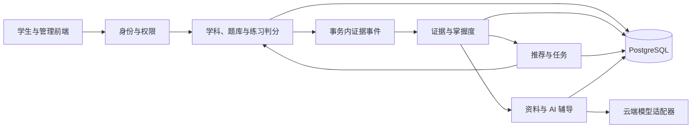

# ReviewSystem 技术设计文档

版本：V0.3（对应需求分析 V0.3，独立开发方案）

日期：2026年11月7日

状态：开发设计基线，尚未实现或通过运行验证。

## 1 目标与设计依据

本文将 [需求分析文档 V0.3](需求分析文档.md) 转化为独立开发方案。ReviewSystem 从零实现，参考 xzs 的业务流程、界面信息布局和代码设计，不复制其源码、数据库脚本、界面素材或构建产物；参考具体实现时记录来源并核查许可证。模块、接口、表和版本均为拟定设计，不代表已实现或验收通过。

首版目标是账号与题库 → 普通练习 → 证据与掌握度 → 推荐任务 → AI 辅导的完整闭环。保留需求中的 P0 功能；P1 追问和审核出题在闭环稳定后评估。

## 2 总体架构与技术选型

采用模块化单体，前后端分离；一个后端进程、一个 PostgreSQL、一个 Vue 应用（学生与管理员路由分别鉴权），暂不要求 Redis、消息中间件或向量数据库。

| 层次 | 建议基线 | 说明 |
| --- | --- | --- |
| 后端 | JDK 21、Spring Boot 3.5.16、Maven 3.9.16 | 与本机 JDK/Maven 匹配；Spring Boot 3.5 要求 Java 17 或以上 [T2] |
| 前端 | Vue 3、Vue Router 4、Pinia、Vite、Node 24.19.0 | 使用锁文件固定实际依赖；Node 满足 Vue 官方脚手架要求 [T3] |
| 数据库 | PostgreSQL 16.15 | 与现有环境匹配；独立建库，使用版本化迁移 [T4] |
| 安全与测试 | Spring Security、BCrypt、JUnit、数据库集成测试 | HTTP-only 会话 Cookie，同源部署；状态变更启用 CSRF 防护 |

Spring Boot 版本及 Vue 依赖版本在初始化工程时验证并锁定；上线或展示前检查维护状态和安全更新。以上只是设计基线，不表示工程已搭建或兼容性测试通过。



## 3 独立模块与依赖

| 模块 | 责任与对外边界 | 前置模块 |
| --- | --- | --- |
| M01 工程基础 | 配置、迁移、错误模型、日志和测试基架 | 无 |
| M02 身份权限 | 注册、登录、会话、角色与资源归属 | M01 |
| M03 学科题库 | 学科、章节、知识点、题目及不可变版本 | M01、M02 |
| M04 普通练习与判分 | 练习、题目快照、草稿、提交、客观题判分和成绩 | M02、M03 |
| M05 证据与掌握度 | 成绩事件、去重、重算与快照 | M03、M04 |
| M06 推荐与解释 | 优先级、选题、规则事实和原因 | M03、M05 |
| M07 复习任务 | 生成、状态、草稿、提交、反馈与活动练习互斥 | M04、M05、M06 |
| M08 课程资料 | 资料录入、版本、发布、撤回和检索 | M02、M03 |
| M09 AI 辅导 | 模型适配、作业、引用校验、额度、降级和反馈 | M05、M07、M08 |
| M10 集成交付 | 安全回归、演示数据、性能、文档和交付 | M01—M09 |

前端页面随对应模块交付，所有模块的 API、迁移、测试和运行说明作为同一交付单元。M06 输出选择建议；M07 负责锁定与保存任务，避免循环依赖。M04 提供通用判分能力，不反向依赖 M07。

## 4 数据模型与约束

所有业务表建议使用 `rs_` 前缀。主键建议 `bigint`，API 中作为字符串传输，避免前端整数精度问题；时间采用带时区时间戳并以 Asia/Shanghai 展示。用户、学科、题目及其外键均由本系统定义并保持类型一致。版本字段、状态采用明确的枚举值，统计计算不使用显示舍入后的数字。

| 拟定表 | 关键字段 | 约束与索引 |
| --- | --- | --- |
| rs_user / rs_session | id, username, password_hash, role, status / session_id, user_id, expiry | 用户名唯一，密码使用自适应哈希；会话服务端管理 |
| rs_subject / rs_chapter | id, name, enabled / id, subject_id, name, sort_order | 章节归属学科，名称约束明确 |
| rs_question | id, subject_id, current_version_id, status | 稳定题号；历史引用不物理删除 |
| rs_practice / rs_practice_item | id, user_id, subject_id, status, request_key / practice_id, question_version_id, draft, result | 与推荐任务共享活动练习约束，保存不可变题目版本和判分结果 |
| rs_knowledge_point | id, subject_id, chapter_key, name, enabled, version | 同学科同章节名称唯一；subject_id 索引 |
| rs_question_version | id, question_id, version, subject_id, knowledge_id, type, content_json, answer_json, explanation, enabled | question_id+version 唯一；内容包含选项与绑定快照；答案字段仅服务端使用 |
| rs_evidence | id, user_id, source_type, submission_id, question_id, question_version_id, knowledge_id, submitted_at, graded_at, correct, revoked, source_revision | source_type+submission_id+question_id 唯一；user_id+knowledge_id+submitted_at 索引 |
| rs_mastery_snapshot | id, user_id, knowledge_id, n, c, score, status, latest_practice_at, cutoff_at, evidence_revision, rule_version, evidence_ids_json | 不可变快照；user_id+knowledge_id+id 索引 |
| rs_mastery_current | user_id, knowledge_id, snapshot_id | user_id+knowledge_id 主键；只指向最新成功结果 |
| rs_student_subject_guard | user_id, subject_id, learning_revision, tutoring_epoch | 联合主键；串行化生成、成绩更新及 AI 状态校验 |
| rs_review_task | id, user_id, subject_id, status, cutoff_at, rule_version, source_revision, request_key, request_hash, result_json | 用户+操作+request_key 幂等；活动唯一性由 rs_learning_activity 保证 |
| rs_task_item | id, task_id, question_id, question_version_id, position, answer_draft_json, draft_version, final_answer_json, result_json, reason_json | task_id+question_id、task_id+position 分别唯一 |
| rs_material_version | id, material_id, version, subject_id, knowledge_id, title, source_label, content, publication_status, approved_by, approved_at | material_id+version 唯一；subject_id+knowledge_id+publication_status 索引 |
| rs_material_chunk | id, material_version_id, position, text | 版本内顺序唯一，资料更新建立新版本 |
| rs_ai_job | id, user_id, subject_id, scenario, context_hash, active_key, snapshot_refs_json, material_refs_json, tutoring_epoch, template_version, model_config_version, state, deadline_at, output_json, usage_json, error_code, expires_at | 活动作业 active_key 部分唯一；用户+创建时间索引；仅保存已校验输出 |
| rs_ai_quota | scope_key, budget_date, used_calls, reserved_cost, actual_cost | scope_key+budget_date 唯一，原子预留额度 |
| rs_ai_feedback | id, user_id, job_id, category, comment, status | 关联归属校验；反馈不进入评分 |
| rs_change_event | id, event_type, source_id, source_revision, state, attempts, next_retry_at, payload_json | 来源+版本+事件类型唯一；状态+下次处理时间索引 |

以 `rs_learning_activity(id,user_id,subject_id,kind,status)` 统一登记普通练习和推荐任务，共享活动唯一约束；各自详情引用该活动 ID，状态更新与详情在同一事务。取消仅限未开始的活动练习；已开始须完成。

JSON 中保存结构化快照，不用 JSON 替代所有可检索字段。答案快照与可发给学生的响应对象必须分开，不能把实体自动序列化后依赖前端隐藏。

PostgreSQL 支持通过条件限定唯一索引适用的行。[T4] 以下为拟定 DDL 示例，需在所选数据库版本和实际状态字段上验证：

```sql
CREATE UNIQUE INDEX uq_rs_activity_active
ON rs_learning_activity(user_id, subject_id)
WHERE status IN ('READY', 'IN_PROGRESS', 'GRADING');

CREATE UNIQUE INDEX uq_rs_ai_inflight
ON rs_ai_job(active_key)
WHERE state IN ('QUEUED', 'RUNNING');
```

历史任务引用的题目、规则快照不物理删除。资料撤回停止新检索和缓存复用，并隐藏相关学生端讲解。AI 内容默认 30 天清理，仅保留不含正文的状态和必要审计信息；成绩按本系统保留策略管理。

## 5 证据、评分与推荐算法

### 5.1 证据归一化与更新

仅接收单选、判断、已最终判分且有可靠主知识点快照的记录。最终提交空答记错误，未提交草稿不计入。事件采用来源版本防止迟到旧事件覆盖新成绩；对更正/撤销进行 upsert 并重算受影响知识点。换绑后的新记录属于新知识点，旧记录仍属于旧快照知识点。

同一学生学科的处理使用 guard 行锁，防止两次重算交错覆盖。事件处理、证据更新、快照写入、current 指针和 learning_revision 更新在一个事务完成；失败整体回滚并重试。事件表保留失败状态，后台扫描可恢复，重复处理不增加证据。首次创建 guard 行使用唯一键冲突安全插入后再加锁。

评分取每个知识点内、每道稳定题号最新有效记录，再按 submitted_at 降序、记录 ID 固定顺序取最多 20 道不同题。这里是“每知识点内去重”，不同知识点的旧/新绑定证据分别归属，不把旧标签改写。撤销最新记录后允许回退到该题上一条有效记录。记录更新时间和 source_revision 只用于处理更正，不能替代 submitted_at 计算复习间隔。

```text
n = 所选不同题数；c = 正确数
n == 0: score = null, status = UNASSESSED
n > 0: M = 100 * (c + 1) / (n + 2)
n < 3: INSUFFICIENT
n >= 3: M < 50 为 WEAK；M < 80 为 CONSOLIDATE；否则 STABLE
```

采用高精度数值计算，阈值和排序使用未显示舍入值。测试例：n=8,c=2 → 30.0；n=1,c=1 → 66.7 但证据不足。时间不使 M 自动下降。

### 5.2 推荐与选题

对 n≥3 且存在有效题目的知识点计算 W=1−M/100、T=min(d/7,1)、E=最近至多5条选中证据错误比例，P=0.60W+0.25T+0.15E。d 为服务器截止时刻到最近有效提交的秒数/86400，异常未来时间记录告警。并列按更早练习时间、知识点 ID 排序。

n<3 独立进入诊断池。两池充足时默认8题复习、2题诊断，不足时互补；总量不足则返回实际题数及缺口原因。复习按前3个有题知识点轮转，耗尽后纳入后续点；诊断按 n、知识点 ID 排序轮转，全新用户先覆盖最多5个有题点。

知识点内依次选择未做题、最近答错题、最久未练的已答对题；按最近作答时间和题号稳定排序。先排除24小时内做过的题，全局不足时再按相同次序放宽冷却；放宽必须标记。任务内稳定题号不重复。每题保存 P 分项、M、n、d、E、证据编号、选择类别、冷却放宽原因及规则版本。

规则配置首版保存在版本化配置中。权重、窗口、阈值、冷却或题数变更必须产生新规则版本；同一输入、截止时间与配置的选题必须一致。

## 6 事务、任务状态与并发

状态机为 READY→IN_PROGRESS→GRADING→COMPLETED，另有 READY→CANCELLED。开始后不能取消；页面关闭不提交。客户端不直接指定状态。

生成任务：验证身份与学科 → 锁 guard → 若评估仍有未处理事件则返回 `ASSESSMENT_UPDATING` → 若已有活动推荐任务则返回该任务，若已有活动普通练习则返回状态冲突及继续入口，否则读取一致的评估/题库快照 → 生成并原子保存任务、题目和原因 → 增加 tutoring_epoch、使在途辅导失效 → 提交事务。题库编辑建立新版本，任务使用已保存的题目版本。唯一索引冲突后重新查询活动练习并按类型返回结果，不能创建第二份活动练习。

草稿采用版本号乐观锁，每题更新需带 `draftVersion`；旧版本返回409，防止迟到请求覆盖新答案。前端5秒防抖、切题保存，界面只有收到成功响应才显示已保存。提交时携带最终完整答案，锁任务后冻结，不能让迟到草稿修改已提交答案。

提交请求使用幂等键和请求摘要；相同键相同内容返回原结果，相同键不同内容返回409。判分同步可完成时在事务内完成状态与结果；采用异步判分时先持久化 GRADING 及可靠作业，重试沿用来源提交编号。最终成绩确认后写证据事件，评估完成前显示更新中，不使用旧成绩悄悄生成下一任务。

任务完成时保存前后快照引用。原成绩与评估失败分离：评估失败不能丢掉已确认成绩，事件重试后更新反馈；“待判分”与“评估更新中”在页面分开显示。

## 7 拟定业务接口

以下路径为本系统 API 约定草案，统一使用服务端会话、状态码与响应封装。列表支持分页，默认20条、最大100条。学生身份来自服务端会话，不接受客户端 `userId` 指定他人。

| 方法与路径 | 主要请求 | 主要结果/限制 |
| --- | --- | --- |
| POST /api/auth/register、/login、/logout | 用户名、密码；退出需 CSRF | 注册仅学生；管理员由初始化流程创建 |
| GET /api/me | 无 | 当前会话用户与角色 |
| GET/POST /api/admin/subjects | 学科字段 | 管理员维护学科 |
| GET/POST /api/admin/questions | 题目、选项、答案、解析 | 管理员维护版本，学生不可调用 |
| POST /api/practices | subjectId、题目选择、幂等键 | 创建普通练习并检查活动互斥 |
| GET /api/practices/{id} | 无 | 本人练习和草稿，不返回答案 |
| POST /api/practices/{id}/start、/cancel | 无 | 幂等开始；仅 READY 可取消 |
| PUT /api/practices/{id}/items/{itemId}/draft | 答案和版本 | 乐观锁保存草稿 |
| POST /api/practices/{id}/submit | 最终答案、幂等键 | 事务判分并持久化事件；完成后才可查看答案 |
| GET /api/practices/{id}/result | 无 | 仅本人完成后查看结果、答案和解析 |
| GET /api/practices/history | 分页 | 本人练习历史 |
| GET /api/review/subjects/{id}/mastery | 分页、状态筛选 | 知识点、M、n、状态、最近练习、更新状态 |
| GET /api/review/knowledge/{id}/history | 分页 | 本人评分快照与规则版本 |
| POST /api/review/tasks | subjectId；Idempotency-Key | 新任务或已有推荐任务；存在普通练习时返回冲突，不含答案 |
| GET /api/review/tasks/{id} | 无 | 本人题目、草稿、规则原因，按状态裁剪 |
| POST /api/review/tasks/{id}/start | 无 | 幂等开始，合法状态检查 |
| PUT /api/review/tasks/{id}/items/{itemId}/draft | answer、draftVersion | 新版本号、服务端保存时间 |
| POST /api/review/tasks/{id}/submit | 最终答案列表；幂等键 | 判分/更新状态，完成后才返回答案解析 |
| POST /api/review/tasks/{id}/cancel | 无 | 仅允许 READY |
| POST /api/review/ai/jobs | scenario、snapshotId 或 taskItemId；幂等键 | 202及 jobId，或授权缓存结果 |
| GET /api/review/ai/jobs/{id} | 无 | 状态；仅成功且权限仍有效时返回输出 |
| POST /api/review/ai/jobs/{id}/feedback | category、comment | 反馈编号 |
| GET/POST/PUT /api/review/admin/knowledge-points | 查询或知识点字段 | 仅管理员；历史引用保护 |
| PUT /api/review/admin/questions/{id}/knowledge | knowledgeId、expectedVersion | 题目新版本及绑定校验 |
| GET /api/review/admin/coverage | subjectId | 缺绑定、无题、无资料统计 |
| GET/POST /api/review/admin/materials | 查询或资料字段 | 草稿与版本列表 |
| POST /api/review/admin/materials/{id}/publish | expectedVersion | 审核发布；校验来源与知识点 |
| POST /api/review/admin/materials/{id}/withdraw | 原因、expectedVersion | 停止检索及相关讲解可见性 |

统一错误码建议：`FORBIDDEN`、`INVALID_BINDING`、`NO_AVAILABLE_QUESTION`、`STATE_CONFLICT`、`IDEMPOTENCY_CONFLICT`、`ASSESSMENT_UPDATING`、`AI_BLOCKED_BY_TASK`、`AI_QUOTA_EXCEEDED`、`AI_SOURCE_INSUFFICIENT`、`AI_TIMEOUT`、`AI_OUTPUT_INVALID`。HTTP 使用400/401/403/404/409/429/503等与错误性质匹配的状态；对外不返回异常栈或供应方原始报错。对象查询先检查归属，未授权资源可统一返回404。

AI 成功响应示意（数值事实单独由后端返回，模型不生成）：

```json
{
  "jobId": "501",
  "state": "SUCCESS",
  "facts": {"mastery": 30.0, "sampleCount": 8, "snapshotId": "101"},
  "guidance": {
    "steps": [{"goal": "理解出栈顺序", "action": "按资料示例逐步画栈", "citationIds": ["c1"]}],
    "possibleConfusions": [{"text": "可能混淆了出栈顺序，请对照操作过程核对", "speculative": true, "citationIds": ["c1"]}]
  },
  "citations": [{"id": "c1", "materialVersionId": "41", "title": "栈操作示例", "chunkId": "42"}]
}
```

## 8 LLM 辅导详细设计

### 8.1 资料检索与上下文

首版仅支持管理员人工录入文本资料。发布时拆分为有完整语义的小段并绑定知识点；按授权学科、知识点和发布状态过滤，再按关键词命中数排序，同分按片段 ID 排序，最多3段。至少有可支持目标概念/解析的内容才调用模型；关键词检索无命中时提示资料不足，不自动联网补充。

上下文由场景模板、规则事实摘要、已完成题目及标准答案（仅错题场景）、授权资料和有限用户问题组成。引用分配局部编号 c1、c2、c3，不允许模型任意生成资料地址。每片段最多1000字符、问题1000字符、整体12000字符；必要题目字段不可截断，超限则拒绝调用。资料存在已知冲突时停止确定性讲解并转人工检查。

### 8.2 模型契约与提示模板

定义 `ModelProvider.generate(request, deadline)`，统一输出原始文本、供应方请求编号、输入/输出用量与错误分类。供应方适配器负责认证、请求格式、超时和格式化能力差异。具体模型通过同一组评测选择，不能只按标价决定。模型/模板/参数发生变化均更新配置版本。

提示模板建议存放在 `prompts/review-guidance-v1` 与 `prompts/error-explanation-v1`（后缀在实现时确定），明确课程范围、事实不得改写、资料为非指令数据、错因只能推测、引用必须来自给定集合。只要求学生可读的解释，不要求模型内部思维链。

输出采用受限 JSON：复习指导要求2—4个步骤；错题讲解要求概念、推导步骤、可能混淆点和自查建议。所有教学段落携带引用集合；拒绝额外数值评分、题号、链接及未知字段。按字段设置长度和数组数量上限，解析失败、引用不合法、空内容或已知答案冲突均返回降级结果。不能自动检测所有事实错误，必须配合人工评测。

### 8.3 作业、缓存、权限与费用

请求先鉴权、检查同学科无活动练习（普通练习或推荐任务），再锁 guard 记录 tutoring_epoch 并创建作业。工作线程领取作业时再次检查；模型返回后锁 guard，校验 epoch、活动练习状态、资料状态及归属仍有效才保存为成功。创建任一种活动练习会增加 epoch，旧作业返回结果必须丢弃。GET 成功结果也重新鉴权并检查当前学科活动练习；活动期间隐藏 AI 内容。

缓存键包含用户、场景、快照、题目/资料版本、模板版本和模型配置版本。同键成功结果直接复用；同键在途作业返回已有编号。失效、到期或撤回资料不得命中。服务重启后，超过deadline的在途作业标记超时，不自动重复外部调用。

调用总时限30秒，单用户1个、全局3个在途调用，默认每日20次实际调用。首版单后端实例，可使用受限线程池及数据库额度行；多实例部署前需将全局并发也做跨实例协调。按供应方可验证的价格和最大输入/输出用量预留费用，已用金额+预留金额不得超过配置日预算。完成后按真实用量结算；计费不明确的失败保留预留并标记待核对，不能假定免费。应用崩溃跨越外部请求的情况下不能保证供应方恰好调用一次，因此不自动重发，保守记账并人工核对。

### 8.4 降级与安全

关闭 AI、额度不足、资料不足、超时、格式错误或供应方故障时，返回明确状态，显示规则摘要、标准答案解析及后续练习入口。作业失败可手动新请求重试，无自动重试。模型原始错误仅映射为内部分类。

密钥仅由服务端环境注入，不发往浏览器或提交仓库。发往供应方的上下文去除姓名、学号、联系方式和其他学生信息。输出以纯文本或禁用HTML的安全Markdown展示，不加载远程图片/任意链接，不执行返回代码、SQL或工具指令。供应方保存策略在选型时核对，演示仅使用虚构数据。

## 9 前端实现约定

独立设计登录注册、学科题库、普通练习、掌握概览、知识点详情、任务执行、任务结果及资料管理页面；参考 xzs 页面布局和交互思路，自行实现路由、请求封装和组件。AI 辅导嵌入概览/结果页，展示事实卡片、讲解、可展开引用、生成时间和反馈。

状态必须可区分：无记录不显示0分；评估更新中保留旧结果并标记；生成任务不足显示实际题数；草稿失败显示未保存；AI生成中可轮询作业状态（建议1秒，完成/离页停止），达到截止时间后重新查询最终状态。请求取消不等于取消供应方调用或退款。活动练习期间辅导入口显示完成练习后可用。

点击“下一次练习”复用任务生成接口；模型不能创建任意跳转链接。P1追问和出题不占首版必需页面，也不在未实现时放置看似可用的按钮。

## 10 配置、启动与迁移

配置示例仅写变量名和虚构值：`AI_ENABLED=false`、`AI_PROVIDER`、`AI_MODEL`、`AI_API_KEY`、`AI_TIMEOUT_SECONDS=30`、`AI_USER_DAILY_CALL_LIMIT=20`、`AI_GLOBAL_DAILY_BUDGET`、`AI_OUTPUT_TOKEN_LIMIT=1500`。实际属性前缀遵循项目配置习惯；未配置价格/预算时不启用真实外部调用。模型服务地址由管理员配置，不从学生请求接收。

创建独立项目时建立迁移目录，按顺序提供建表/约束、知识点与资料演示数据、模拟作答历史；同时提供非破坏性回退说明。默认不回填无可靠快照的历史成绩。升级前备份数据库，迁移失败不得自动删表清空重试。

启动文档最终应写明真实依赖版本、数据库创建、迁移、前后端命令和浏览器入口。在本系统工程实际运行验证前，不发布猜测的启动命令。建议演示采用单台后端、本地数据库、浏览器前端和云端API；先验证 AI 关闭时启动，再验证真实调用。保存历史讲解作为备用时明确标注，不伪装为实时输出。

## 11 开发模块与验收

以下是计划，模块完成必须同时包含后端、前端、迁移、必要测试和文档。A、B 为建议主责，双方评审接口和联调，实际责任以团队安排与提交为准。先纵向打通最小链路，再扩展功能；模块编号不代表已完成。

### M01 工程基础（A、B）

- 实现：独立 `backend/`、`frontend/`、`docs/`；集中配置、环境变量、数据库迁移、统一错误码与基础测试。新建隔离数据库，不导入 xzs 数据。
- 交付：版本锁定、初始化与启动说明、健康检查、空库迁移和测试记录。
- 验收：两台环境能按说明启动并完成数据库迁移；无真实密钥进入仓库。

### M02 身份与权限（A）

- 实现：学生注册、登录退出、管理员初始化、账号禁用、BCrypt 哈希；服务端会话、角色及对象归属，Cookie 设置 HttpOnly、SameSite 和适用场景下 Secure，启用 CSRF 防护与登录失败限速。
- 依赖/交付：M01；用户和会话表、认证接口、登录页面、权限测试。
- 验收：注册不能指定管理员；无凭据、禁用用户、跨角色和跨用户请求被拒绝；密码不以明文或可逆形式保存（AC-21、AC-39）。

### M03 学科、知识点与题库（A）

- 实现：学科、章节、知识点 CRUD/启停，单选与判断题管理、主知识点绑定、覆盖统计；题目稳定编号与不可变版本，答案与学生展示 DTO 分离。
- 依赖/交付：M01、M02；迁移、管理页面、题库接口、版本及校验测试。
- 验收：跨学科绑定被拒绝；版本更新不改变历史快照；可查缺绑定与无题知识点（AC-01、02、24）。

### M04 普通练习与客观题判分（B）

- 实现：选择学科和题目、活动练习、题目快照、草稿恢复、最终提交及历史；单选和判断自动判分，空答为错误；状态和成绩与证据事件同事务保存，提交幂等。
- 依赖/交付：M02、M03；练习和结果接口、页面、事务迁移及测试。通用判分服务供 M07 调用。
- 验收：两类题目正确判分并可恢复草稿，重复提交只产生一个结果；未完成时接口不含正确答案或解析，跨用户不可读（AC-17、21、22、40）。

### M05 证据与掌握度（A）

- 实现：消费 M04/M07 最终成绩事件，按来源版本去重、更正/撤销和重算；保存证据、快照与更新状态，展示样本量、规则和历史变化。
- 依赖/交付：M03、M04；处理器、重试、掌握概览与详情页面、复算测试。
- 验收：无记录、1 题、8 题、重复、撤销和失败恢复可复算；成绩不因评估故障丢失（AC-03—08、23）。

### M06 推荐与解释（B）

- 实现：根据一致快照计算优先级、诊断/复习池、冷却及补题；生成可追溯的事实与题目选择原因，不调用模型。
- 依赖/交付：M03、M05；独立规则服务、规则版本与边界测试。
- 验收：固定输入结果稳定；无记录、题目不足、同分和冷却边界满足 AC-09—14、19—20。

### M07 复习任务与反馈（B）

- 实现：在同一活动练习表上协调 M04 普通练习和推荐任务，生成、开始、取消、草稿、提交、反馈；复用 M04 判分并保存题目与推荐快照。按第 6 节锁和幂等处理。
- 依赖/交付：M04—M06；任务接口与页面、唯一索引和并发测试。
- 验收：同学科最多一个活动练习，重复生成与提交不重复；完成后展示更新状态及旧快照（AC-15—18、24、41）。

### M08 课程资料（A）

- 实现：人工录入、分段、知识点关联、版本、审核发布和撤回，按权限与关键词检索；记录来源。
- 依赖/交付：M02、M03；管理页面、资料接口、迁移与检索测试。
- 验收：未发布、撤回、其他学科或未授权内容不能进入检索；历史引用版本可追溯（AC-25、34）。

### M09 AI 辅导（B）

- 实现：复习指导、完成题目讲解，模型适配、快照上下文、结构和引用校验、额度、缓存、超时、状态复查、降级及反馈；对所有活动练习执行互斥。
- 依赖/交付：M05、M07、M08；模型适配器、模拟供应方、学生辅导和反馈页面、质量评测集。
- 验收：AC-26—36、41；30 例评测按需求保留真实与模拟调用结果，晚到结果不泄露。

### M10 集成、验收与交付（A、B）

- 实现：执行全流程和安全回归、规则性能测试、资料质量评测，编写实际运行、迁移、回退说明，整理报告、PPT 和虚构演示数据。
- 依赖/交付：M01—M09；验收记录、未解决问题清单、可复现演示。
- 验收：全部适用 P0 场景逐项记录结果；完成“注册 → 题库 → 普通练习 → 评估 → 推荐任务 → AI 辅导 → 再练习”，禁用 AI 时规则闭环仍可用。

### 建议并行与接口冻结

A 先负责 M02、M03、M05、M08；B 先准备 M01 前端、M04，再负责 M06、M07、M09。双方先约定用户 ID、题目版本、提交结果、证据事件、活动练习和模型输出契约；M03/M04 及 M05/M06 的交接需提供样例与测试。每模块合并前双方核查依赖和验收，不为提交数量制造空修改。

## 12 待决事项与变更管理

开发前确认 Java 课程登记、具体分工与演示学科。参考 xzs 的调研结果仅用于设计，不导入其代码或数据库；参考具体表达或资源须核查许可并记录来源。模型接入前确定供应方、模型、价格、全局日预算及资料使用范围。

业务规则变化先更新需求，再同步技术文档、规则版本和验收场景；数据库变化通过版本化迁移及备份/回退方案管理。建议 12 月 1 日前冻结 P0，12 月 2—6 日回归和彩排；P1 后移不挤占核心闭环。

## 13 参考资料

- [需求分析 V0.3](需求分析文档.md)：业务规则、功能与验收依据。
- [T1：xzs 官方仓库](https://github.com/mindskip/xzs)：功能、界面和实现思路参考；已核查提交 `378b3f94f0e8108385a66d19f9079b11b7809e6e`，许可证为 AGPL-3.0。
- [T2：Spring Boot 3.5 系统要求](https://docs.spring.io/spring-boot/3.5/system-requirements.html)：Java 与 Maven 兼容要求。
- [T3：Vue 快速入门](https://vuejs.org/guide/quick-start.html)：Node 与 Vue 工程要求。
- [T4：PostgreSQL 版本支持](https://www.postgresql.org/support/versioning/)：数据库版本维护状态；[条件索引](https://www.postgresql.org/docs/16/indexes-partial.html)。
- [OWASP 模型输出处理](https://genai.owasp.org/llmrisk/llm052025-improper-output-handling/)：输出校验和安全渲染参考。
