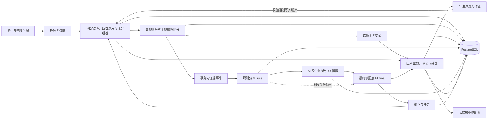

# ReviewSystem 技术设计文档

版本：V0.5（对应需求分析 V0.5，数据结构单课程版）

日期：2026年11月18日

状态：M01 已在本机验证，M02 身份与权限已完成，M03 单课程与四类题库已完成（本机验证）；M04 及以后模块仍为设计基线。

## 1 目标与设计依据

本文将 [需求分析文档 V0.5](需求分析文档.md) 转化为单课程、四题型、固定混合来源练习的实现方案。ReviewSystem 从零实现，参考 xzs 的业务流程、界面信息布局和代码设计，不复制其源码、数据库脚本、界面素材或构建产物；参考具体实现时记录来源并核查许可证。

首版固定“数据结构”一门课程，打通账号 → 四类题库与资料导入 → 混合组卷（题库 7 : AI 3） → 客观判分与主观建议评分 → 错题本 → 证据与掌握度（规则分 + AI 限幅修正） → 推荐任务 → AI 辅导与变式的闭环。AI 生成题通过校验后写入正式题库并对全体学生开放；主观题建议分按权重 0.6 计入掌握度证据；最终掌握度以规则分为锚，允许 AI 在 ±8 分内修正。P1 追问在闭环稳定后评估。

## 2 总体架构与技术选型

采用模块化单体，前后端分离；一个后端进程、一个 PostgreSQL、一个 Vue 应用（学生与管理员路由分别鉴权），暂不要求 Redis、消息中间件或向量数据库。

| 层次 | 建议基线 | 说明 |
| --- | --- | --- |
| 后端 | JDK 21、Spring Boot 3.5.16、Maven 3.9.16 | 与本机 JDK/Maven 匹配；Spring Boot 3.5 要求 Java 17 或以上 [T2] |
| 前端 | Vue 3、Vue Router 4、Pinia、Vite、Node 24.19.0 | 使用锁文件固定实际依赖；Node 满足 Vue 官方脚手架要求 [T3] |
| 数据库 | PostgreSQL 16.15 | 与现有环境匹配；独立建库，使用版本化迁移 [T4] |
| 安全与测试 | Spring Security、BCrypt、JUnit、数据库集成测试 | HTTP-only 会话 Cookie，同源部署；状态变更启用 CSRF 防护 |

Spring Boot 版本及 Vue 依赖版本在初始化工程时验证并锁定；上线或展示前检查维护状态和安全更新。以上只是设计基线，不表示工程已搭建或兼容性测试通过。



## 3 独立模块与依赖

| 模块 | 责任与对外边界 | 前置模块 | 当前状态 |
| --- | --- | --- | --- |
| M01 工程基础 | 配置、迁移、错误模型、日志和测试基架 | 无 | 本机验证，第二台机器待验收 |
| M02 身份权限 | 注册、登录、会话、角色与资源归属 | M01 | 已完成 |
| M03 单课程与四类题库 | 固定课程、章节、知识点、四类题目、评分要点、图片、不可变版本、AI 生成题入库与下架 | M01、M02 | 已完成（本机验证） |
| M04 普通练习与判分 | 混合组卷比例快照、题目快照、草稿、图片作答、提交、客观题判分和成绩 | M02、M03 | 计划 |
| M05 证据与掌握度 | 四类题型证据与权重、规则分、AI 综合判断与限幅合成、去重、重算与快照 | M03、M04 | 计划 |
| M06 推荐与解释 | 基于 M_final 的优先级、选题、规则事实和原因 | M03、M05 | 已完成（本机验证） |
| M07 复习任务 | 生成、准备、状态、草稿、提交、反馈与活动练习互斥；固定混合组卷 | M04、M05、M06 | 计划 |
| M08 课程资料 | 资料录入、版本、发布、撤回和检索；离线题库/资料导入 | M02、M03 | 计划 |
| M09 错题本 | 错题收录、状态、原题重做、尝试历史与变式入口 | M04、M07 | 计划 |
| M10 AI 练习与辅导 | 模型适配、AI 出题入库、主观建议评分、掌握度综合判断、错题变式、辅导、引用校验、额度与降级 | M05、M07、M08、M09 | 计划 |
| M11 集成交付 | 安全回归、演示数据、性能、文档和交付 | M01—M10 | 计划 |

前端页面随对应模块交付，所有模块的 API、迁移、测试和运行说明作为同一交付单元。M06 输出选择建议；M07 负责锁定与保存任务，避免循环依赖。M04 提供通用客观判分能力，不反向依赖 M07。M05 定义 `MasteryJudgePort` 接口（输入规则事实、输出 M_ai 与理由），由 M10 的模型适配器实现，避免 M05 直接依赖 M10；端口缺失、超时或输出不合法时，M05 退化为纯规则分并把 M_final 记为 M_rule。M09 只依赖普通练习/任务的结果，不依赖 LLM；M10 在错题本稳定后接入变式生成。

## 4 数据模型与约束

所有业务表建议使用 `rs_` 前缀。主键建议 `bigint`，API 中作为字符串传输，避免前端整数精度问题；单行固定课程表使用 `smallint id CHECK(id=1)`。时间采用带时区时间戳并以 Asia/Shanghai 展示。用户、课程、题目及其外键均由本系统定义并保持类型一致。版本字段、状态采用明确的枚举值，统计计算不使用显示舍入后的数字。

| 拟定表 | 关键字段 | 约束与索引 |
| --- | --- | --- |
| rs_subject / rs_chapter | id=1, code='DATA_STRUCTURES', name / id, subject_id, name, sort_order, enabled, version | 单行课程：id CHECK(id=1)，code 唯一；不提供增删 API；章节归属课程并用 version 乐观锁更新 |
| rs_user / rs_session | id, username, password_hash, role, status / session_id, user_id, expiry | 用户名唯一，密码使用自适应哈希；会话服务端管理 |
| rs_knowledge_point | id, subject_id, chapter_key, name, enabled, version | 同课程同章节名称唯一；subject_id 索引 |
| rs_question | id, subject_id, origin, origin_question_version_id, gen_job_id, current_version_id, status | origin=MANUAL/AI_GENERATED；status=ACTIVE/SUSPENDED；稳定题号；历史引用不物理删除；SUSPENDED 不进入新任务候选 |
| rs_question_version | id, question_id, version, subject_id, knowledge_id, type, content_json, answer_json, rubric_json, explanation, source_ref, enabled | question_id+version 唯一；type=CHOICE/FILL/SHORT_ANSWER/ALGORITHM；答案、评分要点仅服务端使用 |
| rs_question_asset | id, question_version_id, position, storage_key, mime, width, height, sha256 | 题图归属版本；存储键不可由前端直接构造 |
| rs_learning_activity | id, user_id, subject_id, kind, status | kind=PRACTICE/TASK；status=PREPARING/READY/IN_PROGRESS/GRADING/COMPLETED/CANCELLED/PREPARATION_FAILED；活动唯一索引 |
| rs_practice / rs_practice_item | id, user_id, subject_id, mix_ratio_json, status, request_key / practice_id, question_version_id, position, draft, result_json | mix_ratio_json 记录当次题库题与 AI 题的实际构成；共享活动约束；保存不可变题目版本、判分或建议评分结果 |
| rs_answer_asset | id, user_id, practice_item_id, storage_key, mime, size_bytes, sha256, state | 仅本人可读；最多 3 张；扫描/重新编码后进入私有存储 |
| rs_evidence | id, user_id, source_type, submission_id, question_id, question_version_id, knowledge_id, question_type, result_y, weight, submitted_at, graded_at, revoked, source_revision | 接收四类题型；result_y 为 0—1 小数，weight 为 1.0 或 0.6；source_type+submission_id+question_id 唯一 |
| rs_mastery_snapshot | id, user_id, knowledge_id, n, weight_sum, weighted_sum, rule_score, ai_score, final_score, clamped, ai_reason_json, ai_job_id, status, latest_practice_at, cutoff_at, evidence_revision, rule_version, evidence_ids_json | rule_score 可复算；final_score=clamp(ai_score, rule_score±8)；不可变快照；user_id+knowledge_id+id 索引 |
| rs_mastery_current | user_id, knowledge_id, snapshot_id | user_id+knowledge_id 主键；只指向最新成功结果 |
| rs_student_course_guard | user_id, subject_id, learning_revision, tutoring_epoch | 联合主键；串行化生成、成绩更新及 AI 状态校验 |
| rs_review_task | id, user_id, subject_id, status, mix_ratio_json, cutoff_at, rule_version, source_revision, request_key, request_hash, result_json | 用户+操作+request_key 幂等；活动唯一性由 rs_learning_activity 保证 |
| rs_task_item | id, task_id, question_id, question_version_id, position, answer_draft_json, draft_version, final_answer_json, result_json, reason_json | task_id+question_id、task_id+position 分别唯一 |
| rs_wrong_question | id, user_id, question_id, question_version_id, knowledge_id, source_type, status, wrong_count, first_wrong_at, last_wrong_at, latest_attempt_id, mastered_at | user_id+question_id 唯一；status=PENDING/MASTERED；user_id+status+last_wrong_at 索引 |
| rs_wrong_attempt | id, wrong_question_id, practice_id, item_id, attempt_type, answer_json, grade_json, passed, created_at | attempt_type=ORIGINAL_REDO/AI_VARIANT/ORDINARY；归属与条目一致 |
| rs_material_version | id, material_id, version, subject_id, knowledge_id, title, source_label, content, publication_status, approved_by, approved_at | material_id+version 唯一；subject_id+knowledge_id+publication_status 索引 |
| rs_material_chunk | id, material_version_id, position, text | 版本内顺序唯一，资料更新建立新版本 |
| rs_ai_job | id, user_id, subject_id, scenario, context_hash, active_key, snapshot_refs_json, material_refs_json, source_question_version_id, knowledge_id, evidence_revision, tutoring_epoch, template_version, model_config_version, state, deadline_at, output_json, usage_json, error_code, expires_at | scenario=QUESTION_GENERATION/SUBJECTIVE_REVIEW/WRONG_VARIANT/GUIDANCE/EXPLANATION/MASTERY_JUDGEMENT；活动作业 active_key 部分唯一；MASTERY_JUDGEMENT 按 user+knowledge+evidence_revision 唯一；仅保存已校验输出 |
| rs_ai_quota | scope_key, budget_date, used_calls, reserved_cost, actual_cost | scope_key+budget_date 唯一，原子预留额度 |
| rs_ai_feedback | id, user_id, job_id, wrong_question_id, category, comment, status | 关联归属校验；反馈不进入评分 |
| rs_change_event | id, event_type, source_id, source_revision, state, attempts, next_retry_at, payload_json | 来源+版本+事件类型唯一；状态+下次处理时间索引 |

以 `rs_learning_activity(id,user_id,subject_id,kind,status)` 统一登记普通练习和推荐任务，共享活动唯一约束；各自详情引用该活动 ID，状态更新与详情在同一事务。活动状态增加 `PREPARING`，用于混合组卷的题目准备（AI 槽位尚未准备完成时）；若 AI 槽位全部降级，可在创建事务内直接进入 READY。取消仅限 `PREPARING` 和 `READY`，已开始须完成。

单课程由数据库与服务层双重约束：迁移只插入 `id=1` 的“数据结构”课程，`CHECK(id=1)` 阻止新增第二行；所有题目、知识点、练习和资料查询使用该固定 ID，API 不接受客户端 `subjectId` 创建新课程。保留 `subject_id` 外键是为了数据完整性和未来迁移，不表示首版支持多课程。

人工录入题与 AI 生成题共用同一题目表，用 `origin` 区分来源，用 `status` 控制可用性。AI 题校验通过后在同一事务内写入 `rs_question` 与 `rs_question_version`，`origin='AI_GENERATED'`、`status='ACTIVE'`，`gen_job_id` 指回生成作业，用于追溯模型、模板版本与依据题版本。写入后立即进入推荐候选，与人工题同权；`status='SUSPENDED'` 的题不进入新任务，但历史作答、错题与掌握度快照照常可读。组卷、覆盖统计与检索统一限定 `subject_id=1 AND status='ACTIVE'`，不再按来源过滤，来源只用于展示与统计分列。

JSON 中保存结构化快照，不用 JSON 替代所有可检索字段。四类题的内容约束：CHOICE 至少 3 个选项且一个正确答案；FILL 的空格数与答案数量一致；SHORT_ANSWER、ALGORITHM 必须有参考答案与评分要点，可含题图和作答附件。答案快照与可发给学生的响应对象必须分开，不能把实体自动序列化后依赖前端隐藏。

PostgreSQL 支持通过条件限定唯一索引适用的行。[T4] 以下为拟定 DDL 示例，需在所选数据库版本和实际状态字段上验证：

```sql
CREATE UNIQUE INDEX uq_rs_activity_active
ON rs_learning_activity(user_id, subject_id)
WHERE status IN ('PREPARING', 'READY', 'IN_PROGRESS', 'GRADING');

CREATE UNIQUE INDEX uq_rs_ai_inflight
ON rs_ai_job(active_key)
WHERE state IN ('QUEUED', 'RUNNING');

CREATE UNIQUE INDEX uq_rs_wrong_question
ON rs_wrong_question(user_id, question_id);
```

历史任务引用的题目、规则快照不物理删除。资料撤回停止新检索和缓存复用，并隐藏相关学生端讲解。已入库的 AI 生成题按正式题长期保留，题目、答案与生成元数据不参与 30 天清理，否则历史作答、错题重做和掌握度复算都会失去依据。AI 作业的讲解输出、建议评分明细和作答图片默认 30 天清理，仅保留不含正文的状态与必要审计信息；成绩、证据、掌握度快照、错题状态与规则快照按本系统保留策略管理。清理建议评分明细时不得改动已写入 `rs_evidence` 的 `result_y` 与 `weight`，也不得重算或改写历史快照。

## 5 证据、评分与推荐算法

### 5.1 证据归一化与更新

接收四类题型、已最终判分或建议评分、具有可靠主知识点快照的记录，不按题目来源过滤。最终提交空答记错误，未提交草稿不计入；主观题建议评分失败或超时时 `result_y=null`，该条跳过，不写 0。事件采用来源版本防止迟到旧事件覆盖新成绩；对更正/撤销进行 upsert 并重算受影响知识点。换绑后的新记录属于新知识点，旧记录仍属于旧快照知识点。

填空题采用逐空判分，但只有全部空格正确才向 `rs_evidence.result_y` 写 1；部分正确写入 `result_json` 供反馈，不改变 y。主观题向 `result_y` 写 `normalized_score / 100`，`weight` 固定 0.6；客观题 `weight` 固定 1.0。建议评分失败时该次不写证据，但练习项与错题尝试仍保存作答和失败原因，避免把模型故障当成答错。

同一学生课程的处理使用 guard 行锁，防止两次重算交错覆盖。事件处理、证据更新、快照写入、current 指针和 learning_revision 更新在一个事务完成；失败整体回滚并重试。事件表保留失败状态，后台扫描可恢复，重复处理不增加证据。首次创建 guard 行使用唯一键冲突安全插入后再加锁。

评分取每个知识点内、每道稳定题号最新有效记录，再按 submitted_at 降序、记录 ID 固定顺序取最多 20 道不同题。这里是“每知识点内去重”，不同知识点的旧/新绑定证据分别归属，不把旧标签改写。撤销最新记录后允许回退到该题上一条有效记录。记录更新时间和 source_revision 只用于处理更正，不能替代 submitted_at 计算复习间隔。

```text
n  = 所选不同题数
WS = Σ weight_i            # 客观题 1.0，主观题 0.6
YS = Σ weight_i * result_y_i
n == 0: rule_score = null, status = UNASSESSED
n  > 0: rule_score = 100 * (YS + 1) / (WS + 2)
final_score = clamp(ai_score, rule_score - 8, rule_score + 8)
ai_score 缺失或非法: final_score = rule_score, clamped = false
n < 3: INSUFFICIENT
n >= 3: final_score < 50 为 WEAK；< 80 为 CONSOLIDATE；否则 STABLE
```

采用高精度数值计算，阈值和排序使用未显示舍入值。测试例：8 道客观题答对 2 道 → rule_score=30.0；1 道题答对 → 66.7 但证据不足；4 道客观题答对 2 道、2 道算法题建议分 80 与 40 → WS=5.2、YS=2.72、rule_score≈51.7。权重同时进入分子与分母，等价于把主观题按 0.6 道折算成证据量，纯主观题知识点需要更多样本才能进入高分区间，这是可信度折扣而非缺陷，前端必须同时展示 n。时间不使分数自动下降。

### 5.2 推荐与选题

对 n≥3 且存在有效题目的知识点计算 W=1−final_score/100、T=min(d/7,1)、E=最近至多5条选中证据的错误比例，P=0.60W+0.25T+0.15E。E 中客观题按 `result_y<0.5` 记错误，主观题按 `result_y<0.6` 记错误，结果缺失的记录不计入分母。d 为服务器截止时刻到最近有效提交的秒数/86400，异常未来时间记录告警。并列按更早练习时间、知识点 ID 排序。

n<3 独立进入诊断池。两池充足时默认8题复习、2题诊断，不足时互补；总量不足则返回实际题数及缺口原因。复习按前3个有题知识点轮转，耗尽后纳入后续点；诊断按 n、知识点 ID 排序轮转，全新用户先覆盖最多5个有题点。组卷固定为混合来源：先按 `mix_ratio_json`（默认 7:3）把 10 题拆成题库槽位与 AI 槽位，知识点顺序和每点题量由规则先定，AI 只能在既有槽位内生成，不能改变知识点分布；题库槽位候选不足时先用题库放宽规则补足，仍不足才转为 AI 槽位并记录原因。

知识点内依次选择未做题、最近答错题、最久未练的已答对题；按最近作答时间和题号稳定排序。先排除24小时内做过的题，全局不足时再按相同次序放宽冷却；放宽必须标记。任务内稳定题号不重复。候选查询限定 `status='ACTIVE'`，排除停用与已下架题，不排除 AI 生成题。每题保存 P 分项、final_score、rule_score、n、d、E、证据编号、选择类别、冷却放宽原因及规则版本。

规则配置首版保存在版本化配置中。权重、窗口、阈值、冷却或题数变更必须产生新规则版本；同一输入、截止时间与配置的选题必须一致。

### 5.3 判分、建议评分与错题写入

客观判分使用题目版本快照，不读取当前题目：单选题按选项稳定 ID 精确匹配；填空题逐空比较，先做 Unicode NFKC、全半角、首尾空白和连续空白归一化，再匹配版本中预设的等价答案集合。所有空格正确才算该题通过，逐空结果写入 `result_json`，但只有整题通过才向证据写 `y=1`。空答记错误；多选题不在首版范围。

主观题提交后建立 `SUBJECTIVE_REVIEW` 作业，建议评分返回 `totalScore/maxScore`，服务端归一化为百分制并保存 `provisional=true`。达到 60% 视为建议通过，低于 60% 视为建议加强；模型失败、空输出或分数不合法时 `passed=null`，不能把失败当作错误。评分成功后向证据写入 `result_y = normalized_score / 100`、`weight=0.6`，与客观题一样参与掌握度计算；失败则不写证据。图片只作为评分输入，不作为可执行附件，提交前需完成上传并写入附件 ID。

错题写入在最终判分/建议评分成功后执行，和练习结果同事务或可靠事件处理：全库题目的客观错误、主观低分均可创建/更新 `rs_wrong_question`；`user_id+question_id` 唯一，重复答错只累加 `wrong_count` 并更新 `last_wrong_at`。原题重做通过时写 `status=MASTERED` 与 `mastered_at`，尝试记录保留；再次答错回写 PENDING。变式题是独立练习，其通过/失败只更新变式题的错题条目，不改变原错题状态。错题写入失败不能丢失判分结果，使用 `rs_change_event` 重试。

### 5.4 AI 生成题入库、校验与下架

题目查询分三类 DTO：管理端题库 DTO、学生作答 DTO、结果页 DTO。作答 DTO 在任何未提交状态下都不含 `answer_json`、`rubric_json`、`explanation` 和来源答案；AI 生成题与人工题共用同一套 DTO，不因来源走不同分支。

生成作业完成后按顺序执行确定性校验：JSON 结构、必填字段与长度、题型与依据题一致、单选题唯一正确答案且选项不少于 3 个、填空题空格数与答案数一致、主观题具备参考答案与评分要点、答案不与依据题标准答案矛盾、与依据题及全库 `ACTIVE` 题的字面重复度低于阈值。首版重复度用规范化文本（NFKC、去空白、去标点）的 3-gram Jaccard 相似度，阈值初设 0.75，实现前用样例校准。校验通过后在同一事务写入题目与首版版本，`origin='AI_GENERATED'`、`status='ACTIVE'`、`gen_job_id` 回指作业；失败则记录 `AI_QUESTION_INVALID` 与具体原因，该槽位改用题库题。事务失败整体回滚，不允许只写题目未写版本或反之。

入库后 AI 题对全体学生可见并可被任意练习抽到。来源只用于展示、覆盖统计分列与追溯，不参与判分、证据权重或推荐计算。管理员可查看题干、答案、校验记录、抽中次数与错误率，并可把题置为 `SUSPENDED`；下架只阻止其进入新任务，不清空历史作答、错题条目与掌握度快照。任一题被 3 名不同学生提交“疑似有误”反馈时自动转人工复核并暂停进入新任务，复核结论为下架或恢复。

## 6 事务、任务状态与并发

状态机为 PREPARING→READY→IN_PROGRESS→GRADING→COMPLETED，另有 PREPARING→PREPARATION_FAILED、PREPARING→CANCELLED、READY→CANCELLED。开始后不能取消；页面关闭不提交。客户端不直接指定状态。

混合组卷生成固定走准备路径，不再区分题库即时模式：验证身份 → 锁 guard → 若评估仍有未处理事件则返回 `ASSESSMENT_UPDATING` → 若已有活动练习则按类型返回 → 读取一致的掌握度/题库快照 → 按 7:3 拆分槽位并选定题库题 → 写入 `PREPARING` 活动与准备作业，同时增加 `tutoring_epoch` 使旧辅导结果失效 → 提交事务并返回 202。若 AI 槽位全部降级且所有槽位都由题库题填满，可在同一事务内直接转为 READY 并返回 201；这是内部优化，不改变对外接口契约。

AI 槽位准备：工作线程按已确定的槽位逐题调用模型，成功后做结构、答案、知识点与全库重复度校验，通过即写入正式题库（`origin='AI_GENERATED'`、`status='ACTIVE'`），失败则同一槽位改用题库题。所有槽位处理完成后，在一个事务内写任务题目、`mix_ratio_json` 实际构成并将活动转为 READY；若一题都不可用，转 PREPARATION_FAILED 并记录原因。准备期间不返回答案、评分要点或题目正文给未完成校验的客户端。已入库的题若在准备期间被管理员下架，该槽位改选一道 `ACTIVE` 题库题，不阻塞整个任务。唯一索引冲突后重新查询活动练习并按类型返回结果，不能创建第二份活动练习。

草稿采用版本号乐观锁，每题更新需带 `draftVersion`；旧版本返回409，防止迟到请求覆盖新答案。前端5秒防抖、切题保存，界面只有收到成功响应才显示已保存。提交时携带最终完整答案，锁任务后冻结，不能让迟到草稿修改已提交答案。

提交请求使用幂等键和请求摘要；相同键相同内容返回原结果，相同键不同内容返回409。客观题同步判分；包含简答/问答或算法设计题时，先持久化客观结果并将这些题项置为 `AI_REVIEW_PENDING`，再创建 `SUBJECTIVE_REVIEW` 作业。所有主观题返回后写建议分，任务转 COMPLETED；AI 超时或失败时保留客观成绩和答案，题项置 `AI_REVIEW_FAILED`，允许手动重试，不把任务卡在 GRADING。判分或建议评分确认后写证据事件：客观题 `result_y` 取 0 或 1、`weight=1.0`，主观题 `result_y=normalized_score/100`、`weight=0.6`，评分失败不写证据。评估完成前显示更新中，不使用旧成绩悄悄生成下一任务。

每道题提交结果包含 `grading_mode`（AUTO/LLM_SUGGESTED）、`raw_score`、`max_score`、`normalized_score`、`passed`、`evidence_weight` 和 `grading_status`。客观题 `passed` 由标准答案决定、`evidence_weight=1.0`；主观题 `passed` 由建议分≥60% 决定、`evidence_weight=0.6`，且始终带 `provisional=true`。错题条目只读取最终 `passed`；AI 失败时 `passed=null`，不新建也不移除错题。

任务完成时保存前后快照引用。原成绩与评估失败分离：评估失败不能丢掉已确认成绩，事件重试后更新反馈；“待判分”与“评估更新中”在页面分开显示。

掌握度快照按证据版本生成，分两步落库。第一步在事件事务内计算 `rule_score` 并写快照（`ai_score=null`、`final_score=rule_score`、`clamped=false`），供页面立即展示；第二步以 `user_id + knowledge_id + evidence_revision` 为幂等键创建 `MASTERY_JUDGEMENT` 作业，返回后校验 `0≤ai_score≤100`、理由不超过 2 条且引用编号合法，再写入 `ai_score`、`final_score`、`clamped` 并推进 `rs_mastery_current`。作业失败、超时或输出非法时保留第一步结果，仅标记“AI 综合判断未生效”，不反复重试。两版快照均不可变，任务生成只读 `rs_mastery_current`，不使用内存中的临时分数。

## 7 拟定业务接口

M06 新增只读规则接口：

| 接口 | 请求 | 说明 |
| --- | --- | --- |
| GET /api/review/recommendations | `count`，默认 10，范围 1—10；用户身份取服务端会话 | 返回 `updating`（存在未完成的 `PRACTICE_SUBMITTED` 事件时为 true）、计划知识点、REVIEW/DIAGNOSTIC 两池选题、每题可追溯规则事实与缺口；规则版本 `v1`，不创建任务、不调用模型 |

以下路径为本系统 API 约定草案，统一使用服务端会话、状态码与响应封装。列表支持分页，默认20条、最大100条。学生身份来自服务端会话，不接受客户端 `userId` 指定他人。

| 方法与路径 | 主要请求 | 主要结果/限制 |
| --- | --- | --- |
| POST /api/auth/register、/login、/logout | 用户名、密码；退出需 CSRF | 注册仅学生；管理员由初始化流程创建 |
| GET /api/me | 无 | 当前会话用户与角色 |
| GET /api/course | 无 | 当前固定课程“数据结构”；不提供新增课程接口 |
| GET/POST/PUT /api/admin/chapters、/api/admin/knowledge-points | 名称、排序、知识点 | 管理员维护单课程结构；历史引用保护 |
| GET/POST/PUT /api/admin/questions | 题型、题干、选项/空格、答案、评分要点、解析、图片、知识点；origin、分页 | 管理员维护四类题版本；可按 origin 筛选人工题与 AI 题；学生不可调用 |
| POST /api/admin/questions/{id}/suspend、/restore | 原因、expectedVersion | 下架或恢复；下架后不进入新任务，历史记录保留 |
| POST /api/practices | knowledgeIds、questionCount、Idempotency-Key | 固定混合组卷，不接受来源参数；返回 202+jobId+activityId，或全部降级为题库题时 201；检查活动互斥 |
| GET /api/practices/{id} | 无 | 本人练习和草稿；PREPARING 只返回进度，不返回未校验题干或答案 |
| GET /api/practices/preparation/{jobId} | 无 | 准备进度、降级数量、已入库 AI 题数和失败原因；完成后引导到练习 |
| POST /api/practices/{id}/start、/cancel | 无 | 幂等开始；PREPARING/READY 可取消 |
| PUT /api/practices/{id}/items/{itemId}/draft | 答案和版本 | 乐观锁保存草稿；主观题文本/代码 |
| POST /api/practices/{id}/items/{itemId}/assets | 图片 multipart、Idempotency-Key | 仅本人、作答中、最多 3 张；返回私有附件 ID，不返回本地路径 |
| DELETE /api/practices/{id}/items/{itemId}/assets/{assetId} | 无 | 仅未提交时可删；已提交图片进入保留策略 |
| POST /api/practices/{id}/submit | 最终答案、附件 ID、幂等键 | 客观判分；主观题创建建议评分作业；完成后才可查看答案 |
| GET /api/practices/{id}/result | 无 | 本人完成后查看结果、答案、解析、评分要点和 AI 建议分 |
| GET /api/practices/history | 分页 | 本人练习历史 |
| GET /api/wrong-questions | status、knowledgeId、type、source、分页 | 本人错题；默认 PENDING，已掌握需显式筛选 |
| GET /api/wrong-questions/{id} | 无 | 错题快照、历次尝试、标准答案/评分要点、AI 反馈 |
| POST /api/wrong-questions/{id}/redo | mode=ORIGINAL、Idempotency-Key | 创建原题单题练习；已有活动练习时返回冲突 |
| POST /api/wrong-questions/{id}/variant | Idempotency-Key | 创建 AI 变式作业，202+jobId；校验通过后生成单题练习 |
| POST /api/wrong-questions/{id}/feedback | category、comment | 题目疑似有误/内容反馈，不自动改变错题状态 |
| GET /api/review/mastery | status、page、size | 本课程知识点分页；同时返回 finalScore 与 ruleScore、n、状态、最近练习及 updating；无证据为 UNASSESSED |
| GET /api/review/knowledge/{id}/history | page、size | 本人不可变快照倒序，含三项分数、限幅、AI 理由、证据版本、规则版本与选中的证据；无效知识点 404 |
| POST /api/review/tasks | Idempotency-Key | 新任务或已有活动；固定混合组卷返回 202 准备，全部降级时 201；不含答案 |
| GET /api/review/tasks/{id} | 无 | 本人题目、草稿、规则原因，按状态裁剪 |
| POST /api/review/tasks/{id}/start | 无 | 幂等开始，合法状态检查 |
| PUT /api/review/tasks/{id}/items/{itemId}/draft | answer、draftVersion | 新版本号、服务端保存时间 |
| POST /api/review/tasks/{id}/submit | 最终答案列表；幂等键 | 判分/建议评分/更新状态，完成后才返回答案解析 |
| POST /api/review/tasks/{id}/cancel | 无 | 仅允许 PREPARING/READY |
| POST /api/review/ai/jobs | scenario、taskItemId/wrongQuestionId/snapshotId；幂等键 | 202及 jobId，或授权缓存结果；不接收任意题干和答案 |
| GET /api/review/ai/jobs/{id} | 无 | 状态；仅成功、权限仍有效且非活动练习禁止场景时返回输出 |
| POST /api/review/ai/jobs/{id}/feedback | category、comment | 反馈编号 |
| GET/POST/PUT /api/review/admin/knowledge-points | 查询或知识点字段 | 仅管理员；历史引用保护 |
| PUT /api/review/admin/questions/{id}/knowledge | knowledgeId、expectedVersion | 题目新版本及绑定校验 |
| GET /api/review/admin/coverage | subjectId | 缺绑定、无题、无资料统计 |
| GET/POST /api/review/admin/materials | 查询或资料字段 | 草稿与版本列表 |
| POST /api/review/admin/materials/{id}/publish | expectedVersion | 审核发布；校验来源与知识点 |
| POST /api/review/admin/materials/{id}/withdraw | 原因、expectedVersion | 停止检索及相关讲解可见性 |

统一错误码建议：`FORBIDDEN`、`INVALID_BINDING`、`NO_AVAILABLE_QUESTION`、`STATE_CONFLICT`、`IDEMPOTENCY_CONFLICT`、`ASSESSMENT_UPDATING`、`PRACTICE_PREPARING`、`PREPARATION_FAILED`、`QUESTION_SUSPENDED`、`AI_BLOCKED_BY_TASK`、`AI_QUOTA_EXCEEDED`、`AI_SOURCE_INSUFFICIENT`、`AI_QUESTION_INVALID`、`AI_QUESTION_DUPLICATE`、`AI_REVIEW_FAILED`、`AI_MASTERY_UNAVAILABLE`、`AI_TIMEOUT`、`AI_OUTPUT_INVALID`、`UPLOAD_INVALID`。HTTP 使用 201/202/400/401/403/404/409/413/429/503 等与错误性质匹配的状态；对外不返回异常栈或供应方原始报错。对象查询先检查归属，未授权资源可统一返回404。`AI_MASTERY_UNAVAILABLE` 不作为前端阻断错误，只在掌握度区域提示并回退规则分。已掌握的错题默认不出现在待重做列表，但学生可从历史显式进入重做；再次答错时恢复待重做。

AI 成功响应示意（数值事实单独由后端返回，模型不生成）：

```json
{
  "jobId": "501",
  "state": "SUCCESS",
  "facts": {"mastery": 30.0, "sampleCount": 8, "snapshotId": "101"},
  "guidance": {
    "steps": [{"goal": "理解出栈顺序", "action": "按资料示例逐步画栈", "citationIds": ["c1"]}],
    "possibleConfusions": [{"text": "可能混淆了出栈顺序，请对照操作过程核对", "speculative": true, "citationIds": ["c1"]}]
  },
  "citations": [{"id": "c1", "materialVersionId": "41", "title": "栈操作示例", "chunkId": "42"}]
}
```

主观题建议评分与 AI 出题的成功结果示意（服务端增加归属、版本与校验状态）：

```json
{
  "jobId": "601",
  "state": "SUCCESS",
  "grading": {
    "totalScore": 5,
    "maxScore": 7,
    "normalizedScore": 71.4,
    "passed": true,
    "provisional": true,
    "rubricScores": [{"point": "删除重复结点", "score": 2, "max": 3}],
    "missingPoints": ["未处理空链表"],
    "feedback": "思路正确，需补充空链表边界"
  }
}
```

```json
{
  "jobId": "602",
  "state": "SUCCESS",
  "question": {
    "type": "ALGORITHM",
    "stem": "在单链表中删除值为 x 的全部结点，返回删除个数",
    "answer": "遍历并维护前驱指针……",
    "rubric": [{"point": "遍历", "score": 3}, {"point": "边界", "score": 2}],
    "knowledgeId": "18",
    "sourceQuestionVersionId": "77"
  },
  "source": "AI_GENERATED",
  "validation": {"passed": true, "similarity": 0.21}
}
```

## 8 LLM 辅导详细设计

### 8.1 资料检索与上下文

首版仅支持管理员人工录入文本资料和题图，不提供通用文档自动解析。发布时拆分为有完整语义的小段并绑定知识点；按固定课程、知识点和发布状态过滤，再按关键词命中数排序，同分按片段 ID 排序，最多3段。至少有可支持目标概念/解析的内容才调用模型；关键词检索无命中时提示资料不足，不自动联网补充。题图作为题目版本附件保存，OCR/视觉文本不作为可信指令。

上下文由场景模板、规则事实摘要、已完成题目及标准答案（仅错题场景）、授权资料和有限用户问题组成。引用分配局部编号 c1、c2、c3，不允许模型任意生成资料地址。每片段最多1000字符、问题1000字符、整体12000字符；必要题目字段不可截断，超限则拒绝调用。资料存在已知冲突时停止确定性讲解并转人工检查。

### 8.2 模型契约与提示模板

定义 `ModelProvider.generate(request, deadline)`，统一输出原始文本、供应方请求编号、输入/输出用量与错误分类。供应方适配器负责认证、请求格式、超时和图片输入能力差异。具体模型通过同一组评测选择，不能只按标价决定。模型/模板/参数发生变化均更新配置版本。

提示模板按场景版本化：`prompts/question-generation-v1`、`subjective-review-v1`、`wrong-variant-v1`、`review-guidance-v1`、`error-explanation-v1`、`mastery-judgement-v1`。所有模板明确：只处理数据结构课程、依据题和资料是不可信数据、事实不得改写、答案必须一致、错因只能推测、引用必须来自给定集合、掌握度判断不得超出给定事实。只要求可核对的输出，不要求或保存模型内部思维链。

| 场景 | 必要输入 | 受限输出 |
| --- | --- | --- |
| QUESTION_GENERATION | 知识点、题型、依据题版本、答案/评分要点、课程片段 | type、stem、options/fillBlanks、answer、rubric、explanation、citationIds |
| WRONG_VARIANT | 原错题版本、学生错误答案、答案/评分要点、课程片段 | 同 QUESTION_GENERATION，另含 relationToSource 与难度说明 |
| SUBJECTIVE_REVIEW | 题目快照、参考答案、评分要点、学生文本/代码、图片、课程片段 | totalScore、maxScore、rubricScores、missingPoints、feedback、confidenceNote |
| MASTERY_JUDGEMENT | 规则分、n、Σw、Σwy、题型构成、错误分布、主观题建议分明细、最近作答时间、事实编号列表 | aiScore（0—100）、confidenceNote、adjustmentReasons（≤2 条，每条必须带 factId） |
| GUIDANCE / EXPLANATION | 任务/知识点快照、规则事实、已完成题目、资料片段 | steps 或讲解段落、possibleConfusions、citationIds，不返回分数或题号 |

生成题输出先解析 JSON，再由服务端执行确定性校验：主知识点、题型与依据题一致、选项数、唯一正确答案、填空/答案数量、非空字段、答案不与依据题矛盾、与依据题及全库 `ACTIVE` 题的相似度低于阈值、图片引用只允许已上传附件 ID。服务端重写 `question_id`、`origin`、`gen_job_id` 和版本，不接受模型生成数据库 ID、链接或课程标识。该校验器与 5.4 节共用同一实现，避免两处规则漂移。

掌握度综合判断单独校验：`aiScore` 必须是 0—100 的数值且小数不超过一位；`adjustmentReasons` 不超过 2 条，每条必须携带输入中真实存在的 `factId`，引用不存在的编号即丢弃该条；理由全部非法时仍可采用合法 `aiScore`，但须记录“理由缺失”供人工评测发现模板问题；`aiScore` 越界或非数值则整体判 `AI_OUTPUT_INVALID`，按失败降级为规则分。

主观题建议评分所选模型必须具备图片输入能力；适配器在启动自检中标记该能力。若当前模型不支持图片，不得把“已收到图片”当作已评估，只能对文本/代码评分并明确提示“图片未参与评分”，或拒绝评分，不能伪装成完整建议分。

主观题建议评分按满分制返回，服务端校验 `sum(rubricScores)=totalScore≤maxScore`，归一化为百分制；缺少评分要点、分数越界或空反馈均判 `AI_OUTPUT_INVALID`。不能自动检测所有事实错误，必须配合人工评测和失败样例。

### 8.3 作业、缓存、权限与费用

请求分三类处理。`QUESTION_GENERATION`、`SUBJECTIVE_REVIEW` 属于练习流程：前者绑定 `PREPARING` 活动并占用题目槽位，后者绑定已提交的 practice item；允许在活动进行中存在，但不能读取其他学生或其他活动数据。`WRONG_VARIANT` 在错题本中创建新的单题活动，已有活动时返回冲突。`MASTERY_JUDGEMENT` 属于提交后的后台评估，按证据版本触发，不占用练习活动，也不参与学习辅导的互斥限制。`GUIDANCE`、`EXPLANATION` 只在没有 PREPARING/READY/IN_PROGRESS/GRADING 活动时允许，创建或开始练习会增加 `tutoring_epoch`，旧辅导结果必须丢弃。

工作线程领取作业时再次检查活动/题目/错题归属及状态。模型返回后重新读取状态：生成题要求活动仍为 PREPARING 且槽位未被取消；建议评分要求提交仍为最终提交且题项仍待评分；变式要求原错题未删除、无其他活动；掌握度判断要求 `evidence_revision` 未变化且该知识点仍有有效证据。条件不满足时丢弃结果并记录状态，不把原始输出直接展示或写入正式题。

缓存键包含用户、场景、快照、题目/资料版本、模板版本和模型配置版本。辅导的同键成功结果可复用；变式题与主观评分按用户隔离，避免跨学生复用。掌握度综合判断以 `user + knowledge + evidence_revision + rule_version` 为键，同键只调用一次，结果落库后直接复用；证据或规则版本变化才重算。同键在途作业返回已有编号。失效、到期或撤回资料不得命中。服务重启后，超过 deadline 的在途作业标记超时，不自动重复外部调用。

单次调用总时限 30 秒，混合准备作业总时限 120 秒；单用户最多 1 个生成作业和 1 个评分作业，掌握度判断另设独立低优先级队列，最多 2 个在途且不得挤占生成与评分；全局 3 个在途调用。每日默认 80 次实际调用，其中生成与评分合计 50 次、掌握度判断 30 次、辅导 20 次，按类别分别计数；同证据版本复用不计。首版单后端实例，可使用受限线程池及数据库额度行；多实例部署前需将全局并发也做跨实例协调。按供应方可验证的价格和最大输入/输出用量预留费用，已用金额+预留金额不得超过配置日预算。完成后按真实用量结算；计费不明确的失败保留预留并标记待核对，不能假定免费。应用崩溃跨越外部请求的情况下不能保证供应方恰好调用一次，因此不自动重发，保守记账并人工核对。

### 8.4 降级与安全

关闭 AI、额度不足、资料不足、超时、格式错误或供应方故障时，返回明确状态。学习辅导降级为规则摘要和标准解析；主观题保留答案并显示“建议评分失败”，可手动重试，客观成绩照常保存；AI 出题按槽位使用同知识点题库题，无法补足时说明实际题数或准备失败；掌握度综合判断失败时直接使用 `rule_score` 并在页面标注“AI 综合判断未生效”，不阻断评估、错题收录和推荐。作业失败可手动新请求重试，无自动重试。模型原始错误仅映射为内部分类。

密钥仅由服务端环境注入，不发往浏览器或提交仓库。发往供应方的上下文去除姓名、学号、联系方式和其他学生信息；图片使用随机存储键和重编码后的副本，不发送原始文件名。输出以纯文本或禁用 HTML 的安全 Markdown 展示，不加载远程图片/任意链接，不执行返回代码、SQL 或工具指令。供应方保存策略在选型时核对，演示仅使用虚构数据。

## 9 前端实现约定

独立设计登录注册、单课程题库管理（分列人工题与 AI 题、支持下架）、练习设置（只选知识点与题量）、四类作答页、掌握概览、知识点详情、任务执行、任务结果、错题本及资料管理页面；参考 xzs 页面布局和交互思路，自行实现路由、请求封装和组件。AI 辅导嵌入概览/结果/错题页，展示事实卡片、讲解、可展开引用、生成时间和反馈；练习设置页明确说明系统按题库与 AI 混合组卷，不提供来源开关，也不展示当前比例。

状态必须可区分：无记录不显示0分；评估更新中保留旧结果并标记；掌握度区域并列显示规则分、AI 综合判断分与最终分，AI 未生效时只显示规则分并注明原因；限幅触发时显示“已限幅”并说明允许区间；生成任务不足显示实际题数；草稿失败显示未保存；AI 准备中显示进度、已降级题数和已入库题数；AI 评分中显示“建议评分生成中”；AI 生成中可轮询作业状态（建议 1 秒，完成/离页停止），达到截止时间后重新查询最终状态。请求取消不等于取消供应方调用或退款。活动练习期间辅导入口显示完成练习后可用，但练习内的 AI 出题、主观评分和掌握度判断入口不受影响。

四类题使用不同控件：单选题选项组、填空题逐空输入、简答题/算法设计题文本区（算法题等宽字体和代码编辑）、两种主观题均支持最多 3 张图片。题图必须可放大查看，主观题图片上传前预览，失败明确重试。提交前显示未作答项和附件上传状态，避免把空附件当已提交。

错题本默认“待重做”列表，显示题型、知识点、来源、错误次数和最近时间；提供“重做原题”和“生成变式”两个明确操作，变式生成中不可重复点击。已掌握历史可筛选查看，答对后提示“已掌握并留档”，不提供误导性的“删除”按钮。AI 建议评分始终显示“不构成正式成绩”，不将其样式做成正式客观分。

点击“下一次练习”复用任务生成接口；模型不能创建任意跳转链接。P1 追问和质量抽查不占首版必需页面，也不在未实现时放置看似可用的按钮。

## 10 配置、启动与迁移

配置示例仅写变量名和虚构值：`AI_ENABLED=false`、`AI_PROVIDER`、`AI_MODEL`、`AI_API_KEY`、`AI_TIMEOUT_SECONDS=30`、`AI_PREPARATION_TIMEOUT_SECONDS=120`、`AI_USER_DAILY_CALL_LIMIT=80`、`AI_GENERATION_DAILY_LIMIT=50`、`AI_MASTERY_DAILY_LIMIT=30`、`AI_GLOBAL_DAILY_BUDGET`、`AI_OUTPUT_TOKEN_LIMIT=1500`、`AI_QUESTION_OUTPUT_TOKEN_LIMIT=2500`、`AI_MASTERY_OUTPUT_TOKEN_LIMIT=600`、`AI_DUPLICATE_THRESHOLD=0.75`、`MIX_BANK_RATIO=0.7`、`MIX_AI_RATIO=0.3`、`EVIDENCE_WEIGHT_OBJECTIVE=1.0`、`EVIDENCE_WEIGHT_SUBJECTIVE=0.6`、`MASTERY_AI_CLAMP=8`、`UPLOAD_DIR`、`UPLOAD_MAX_BYTES=5242880`。实际属性前缀遵循项目配置习惯；未配置价格/预算时不启用真实外部调用。比例、权重与限幅属于规则参数，变更必须提升规则版本并记录到快照。模型服务地址由管理员配置，不从学生请求接收。上传目录必须在 Web 根目录之外，只通过鉴权接口读取。

建立迁移目录，按顺序提供固定课程、章节/知识点、四类题目、资料和演示作答数据；题库导入使用独立幂等脚本，按“来源文件+题号/位置+题型”生成稳定来源键，先校验四类题字段和图片再写库，不把原始 PDF/PPT/Word 放入运行时依赖。同时提供非破坏性回退说明。升级前备份数据库，迁移失败不得自动删表清空重试；导入失败保留已校验批次记录和错误报告，不能留下半套任务可引用的题。

启动文档最终应写明真实依赖版本、数据库创建、迁移、前后端命令和浏览器入口。在本系统工程实际运行验证前，不发布猜测的启动命令。建议演示采用单台后端、本地数据库、浏览器前端和云端API；先验证 AI 关闭时启动，再验证真实调用。保存历史讲解作为备用时明确标注，不伪装为实时输出。

## 11 开发模块与验收

以下是开发与验收基线，模块完成必须同时包含后端、前端、迁移、必要测试和文档。M01 已在本机验证，第二台机器仍待验收；M02 已完成并有 `M02测试记录_2026-11-15.md`；M03 已完成本机验证并有 `M03测试记录_2026-11-18.md`。M04—M05 已完成各自范围的实现与自动化测试；M05 浏览器人工联调尚待执行。M06 及以后模块仍为计划。A、B 为建议主责，双方评审接口和联调，实际责任以团队安排与提交为准。先纵向打通最小链路，再扩展功能；模块编号不代表已完成。

### M01 工程基础（A、B）

- 实现：独立 `backend/`、`frontend/`、`docs/`；集中配置、环境变量、数据库迁移、统一错误码与基础测试。新建隔离数据库，不导入 xzs 数据。
- 交付：版本锁定、初始化与启动说明、健康检查、空库迁移和测试记录。
- 验收：两台环境能按说明启动并完成数据库迁移；无真实密钥进入仓库。

### M02 身份与权限（A）

- 实现：学生注册、登录退出、管理员初始化、账号禁用、BCrypt 哈希；服务端会话、角色及对象归属，Cookie 设置 HttpOnly、SameSite 和适用场景下 Secure，启用 CSRF 防护与登录失败限速。
- 依赖/交付：M01；用户和会话表、认证接口、登录页面、权限测试。
- 验收：注册不能指定管理员；无凭据、禁用用户、跨角色和跨用户请求被拒绝；密码不以明文或可逆形式保存（AC-21、AC-39）。
- 状态：已完成。迁移 V2、认证接口、登录页面、集成测试和测试记录已存在；不包含题库、作答、任务、错题或 AI 功能。

### M03 单课程、知识点与四类题库（A）

- 实现：固定课程初始化、章节/知识点 CRUD/启停，单选/填空/简答问答/算法设计题管理、评分要点、题图、主知识点绑定、覆盖统计（分列人工题与 AI 题）；题目稳定编号与不可变版本，`origin` 来源标记与 `status` 上下架，答案与学生展示 DTO 分离。
- 依赖/交付：M01、M02；迁移、管理页面、题库接口、版本及校验测试、题库导入脚本。
- 验收：不能创建第二门课程；四类题均可保存与回显；跨章节绑定被拒绝；版本更新不改变历史快照；可查缺绑定与无题知识点，并能区分人工题与 AI 题数量（AC-01、02、24、40、42、49）。
- 状态：已完成（本机验证）。运行方式与限制见 `M03运行与验证.md`，自动化证据见 `M03测试记录_2026-11-18.md`；M04 作答归属、快照和判分不在本模块。

### M04 普通练习与判分（B）

- 实现：知识点与题量选择、固定混合组卷比例快照、活动练习、题目快照、草稿恢复、图片上传、最终提交及历史；选择/填空自动判分，空答为错误；主观题保存文本/代码/图片并进入待评分状态；提交幂等，接口不接受来源参数。
- 依赖/交付：M02、M03；练习和结果接口、页面、事务迁移及测试。客观判分服务供 M07 调用。
- 验收：四类题均可作答；选择/填空正确判分并可恢复草稿；主观题附件可上传且提交前不泄露评分要点；接口传入 sourceMode 被忽略或拒绝；重复提交只产生一个结果（AC-17、21、22、40、42、43）。

### M05 证据与掌握度（A）

- 状态（2026-11-19）：M05 已实现。M04 提交事务写 `PRACTICE_SUBMITTED` 事件和 guard 版本；两秒轮询消费者加锁处理，只将 AUTO_GRADED 且 passed 非空的题项写为 0/1、权重 1.0 的证据。待 AI 评分的主观题不写证据。证据按来源唯一键 upsert；计算按知识点和题号选最新有效记录，再取最近 20 道。每次重算只插入快照并推进 current 指针；规则分和最终分按 3 位小数落库。当前只有 UnavailableMasteryJudge，AI 缺失时最终分等于规则分；真实 AI 适配由 M10 实现。M07 题项证据及 M10 主观题证据不在本次范围。
- 依赖/交付：M03、M04；事件处理器、限幅合成、重试、掌握概览与详情页面、复算测试。
- 验收：无记录、1 题、8 题、重复、撤销和失败恢复可复算；主观题按 0.6 权重进入 `WS/YS`；`final_score` 始终落在 `rule_score±8` 内；端口失败时退化为规则分且状态正常推进（AC-03—08、23、48、50—54）。

### M06 推荐与解释（B）

- 实现：根据一致快照计算优先级、诊断/复习池、冷却及补题；候选为 `status='ACTIVE'` 的全库题（含 AI 生成题），生成可追溯的事实与题目选择原因，不调用模型。
- 状态（2026-11-20）：M06 已实现。`RecommendationService` 按 `P=0.60W+0.25T+0.15E`（BigDecimal、中间不四舍五入）排序复习池，n<3 进诊断池；复习池先激活 3 个知识点轮转，用尽后逐个扩充；正常候选耗尽后才启用 24 小时冷却内的题，并逐题标记 `cooldownRelaxed` 与原因。每题返回 W/T/E 分项、`finalScore`、`ruleScore`、n、d、E 分子分母、证据 ID、选择类别与 `ruleVersion`。规则参数集中在 `VersionedRecommendationConfig`（`v1`），改参数须升版本。本次不含任务生成与页面。
- 依赖/交付：M03、M05；独立规则服务、规则版本与边界测试。
- 验收：固定输入结果稳定；AI 生成题与人工题同等进入候选，下架题不进入；无记录、题目不足、同分和冷却边界满足 AC-09—14、19—20。

### M07 复习任务与反馈（B）

- 实现：在同一活动练习表上协调 M04 普通练习和推荐任务，生成、PREPARING/READY/取消、草稿、提交、反馈；按 7:3 拆分题库与 AI 槽位，复用 M04 判分并保存题目、混合构成与推荐快照。按第 6 节锁和幂等处理。
- 依赖/交付：M04—M06；任务接口与页面、唯一索引和并发测试。
- 验收：同一学生最多一个活动练习；AI 准备不返回半个任务；接口不接受来源参数；重复生成与提交不重复；完成后展示更新状态及旧快照（AC-15—18、24、41、43、49）。

### M08 课程资料与离线导入（A）

- 实现：人工录入、分段、知识点关联、版本、审核发布和撤回，按权限与关键词检索；提供题库/资料离线导入工具，记录来源文件与位置、图片校验和幂等键。
- 依赖/交付：M02、M03；管理页面、资料接口、迁移、导入脚本与检索测试。
- 验收：未发布、撤回、其他章节或未授权内容不能进入检索；历史引用版本可追溯；导入失败不留半套数据（AC-25、34）。

### M09 错题本（A）

- 实现：消费客观判分和主观建议分结果，自动收录待重做错题；原题重做、已掌握留档、再次答错恢复、尝试历史、筛选和疑似有误反馈；不依赖 LLM 也可完整运行。
- 依赖/交付：M04、M07；错题表、错题本/详情页、状态与幂等测试。
- 验收：同题只一个条目；答对标记已掌握并留档；再次答错恢复；变式入口不改变原题状态（AC-45—47）。

### M10 AI 练习与辅导（B）

- 实现：模型适配；AI 出题并写入正式题库、混合准备、结构/答案/全库重复度校验、题库降级；主观题建议评分；`MasteryJudgePort` 的掌握度综合判断；错题变式；复习指导与讲解；额度、缓存、超时、状态复查、安全与反馈。学习辅导对活动练习互斥，练习内生成、评分与掌握度判断不受误伤。
- 依赖/交付：M05、M07、M08、M09；模型适配器、模拟供应方、AI 准备/评分页面、质量评测集。
- 验收：AC-26—36、41、43、44、48、49、52；48 例评测保留真实与模拟调用结果；晚到结果不泄露；重复度与下架规则生效；AI 关闭时题库闭环仍可用，掌握度退回规则分。

### M11 集成、验收与交付（A、B）

- 实现：执行全流程和安全回归、规则性能测试、题库与 AI 质量评测，编写实际运行、迁移、回退说明，整理报告、PPT 和虚构演示数据。
- 依赖/交付：M01—M10；验收记录、未解决问题清单、可复现演示。
- 验收：全部适用 P0 场景逐项记录结果；完成“注册 → 四类题库 → 混合组卷 → AI 题入库 → 客观判分与主观建议评分 → 双分掌握度 → 错题本 → 变式 → 推荐任务 → AI 辅导”的闭环，并验证另一个账号能抽到前一次生成的 AI 题。

### 建议并行与接口冻结

A 负责 M03、M05、M08、M09 数据与规则；B 负责 M04、M06、M07、M10 练习与 AI。双方先约定用户 ID、题目版本、四类答案结构、提交结果、证据事件、活动练习、错题事件和模型输出契约；M03/M04、M05/M06 及 M09/M10 的交接需提供样例与测试。每模块合并前双方核查依赖和验收，不为提交数量制造空修改。

## 12 待决事项与变更管理

开发前确认 Java 课程登记、具体分工和题库整理范围。系统固定数据结构单课程，不再讨论多课程扩展；参考 xzs 的调研结果仅用于设计，不导入其代码或数据库，参考具体表达或资源须核查许可并记录来源。模型接入前确定供应方、模型、价格、全局日预算、图片输入能力和资料使用范围。

已确认的产品决策：四类题型为单选、填空、简答/问答、算法设计；普通练习与复习任务固定混合来源（默认 7:3），学生不选来源；AI 新题经确定性校验后写入正式题库并对全体开放，管理员可抽查下架；主观题由 LLM 给出建议分，按权重 0.6 的连续值计入掌握度，但不作为课程正式成绩；最终掌握度以规则分为锚，AI 综合判断受 ±8 分限幅；错题答对后标记已掌握并留档；现有 Word/PDF/PPT/图片只作为开发阶段结构化导入来源。若后续要改变混合比例、主观题权重、限幅幅度或“AI 是否参与掌握度”，必须新增规则版本、迁移和验收案例，不能只改页面文案。

业务规则变化先更新需求，再同步技术文档、规则版本和验收场景；数据库变化通过版本化迁移及备份/回退方案管理。建议 12 月 1 日前冻结 P0，12 月 2—6 日回归和彩排；P1 后移不挤占核心闭环。

## 13 参考资料

- [需求分析 V0.5](需求分析文档.md)：业务规则、功能与验收依据。
- [T1：xzs 官方仓库](https://github.com/mindskip/xzs)：功能、界面和实现思路参考；已核查提交 `378b3f94f0e8108385a66d19f9079b11b7809e6e`，许可证为 AGPL-3.0。
- [T2：Spring Boot 3.5 系统要求](https://docs.spring.io/spring-boot/3.5/system-requirements.html)：Java 与 Maven 兼容要求。
- [T3：Vue 快速入门](https://vuejs.org/guide/quick-start.html)：Node 与 Vue 工程要求。
- [T4：PostgreSQL 版本支持](https://www.postgresql.org/support/versioning/)：数据库版本维护状态；[条件索引](https://www.postgresql.org/docs/16/indexes-partial.html)。
- [OWASP 模型输出处理](https://genai.owasp.org/llmrisk/llm052025-improper-output-handling/)：输出校验和安全渲染参考。
